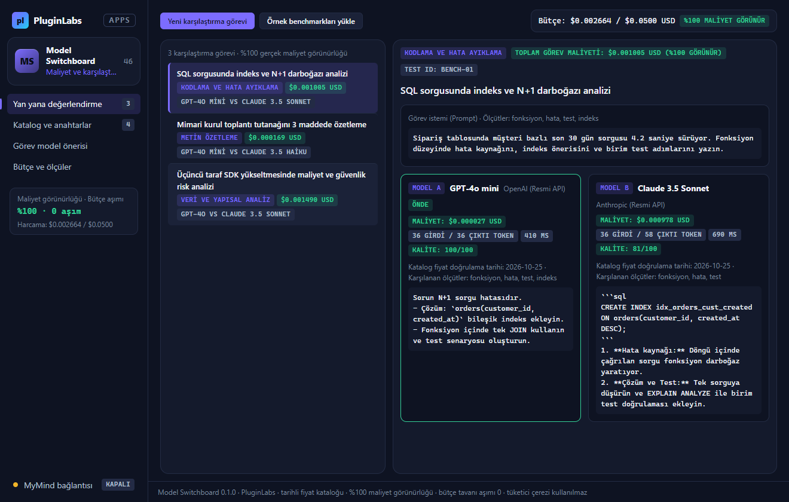
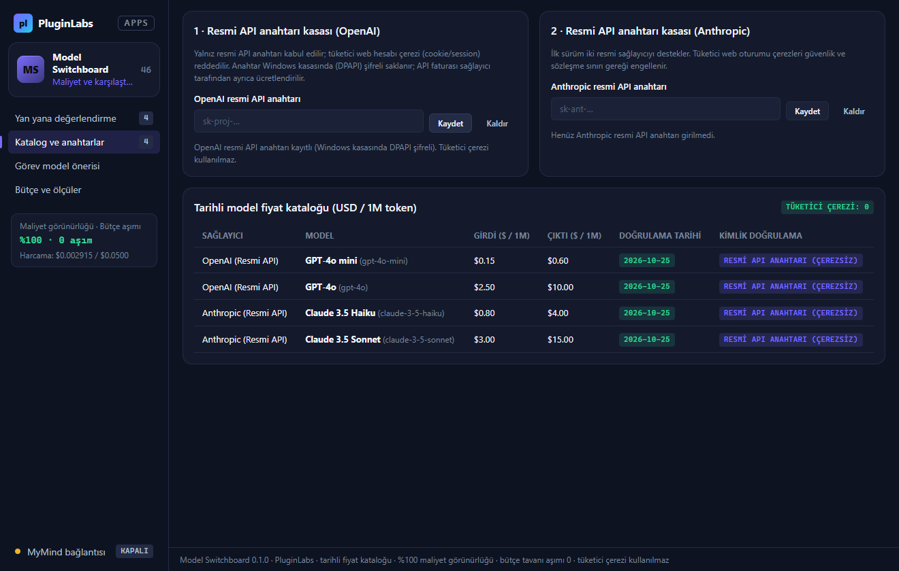
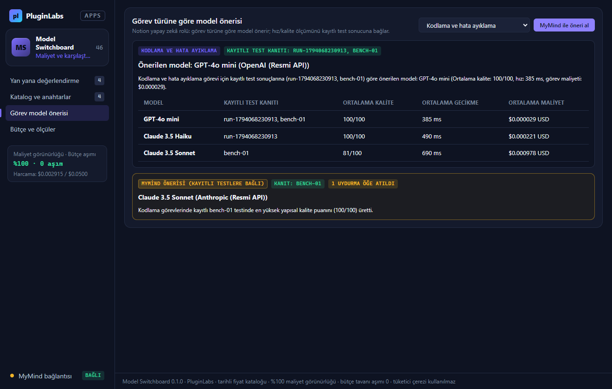
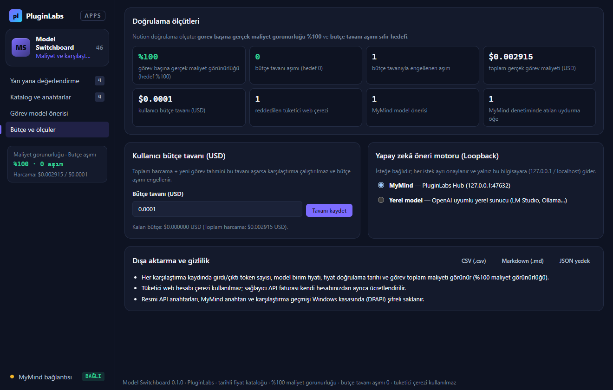
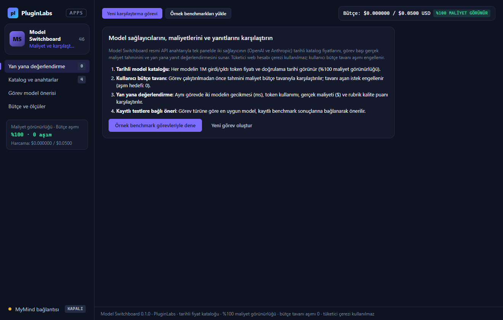

# Model Switchboard (PL-046) — Windows uygulaması

Model sağlayıcılarını, **tarihli katalog fiyatlarıyla** istek maliyetlerini ve aynı görevde ürettikleri yanıtları **yan yana** karşılaştırın. Model Switchboard **resmi API anahtarıyla** tek panel sunar; **tüketici web hesabı çerezi (cookie/session) kullanılmaz**. Her karşılaştırma görevinde girdi/çıktı token sayısı ve gerçek görev maliyeti görünür (**%100 maliyet görünürlüğü**), **kullanıcı bütçe tavanı** aşılmadan önce aşırı istekler engellenir (**bütçe tavanı aşımı sıfır hedefi**) ve görev türüne göre model önerisi **kayıtlı test (benchmark) sonuçlarına** bağlanır.

> Ürün deposu henüz yok; kaynak bu klasördedir (PluginLabs ürün ön geliştirme alanı). Windows paketleri `pluginlabs-dagitim` deposunda `model-switchboard-v<sürüm>` etiketiyle yayımlanır.



| Tarihli model fiyat kataloğu ve resmi API kasası | Görev türüne göre kayıtlı testlere bağlı model önerisi |
| --- | --- |
|  |  |
| **Bütçe tavanı ve doğrulama ölçütleri** | **Başlangıç** |
|  |  |

## Kullanım
1. **Yan yana değerlendirme**: İlk deneme için **Örnek benchmarkları yükle** veya **Yeni karşılaştırma görevi** düğmesiyle görev istemini, ölçütleri ve karşılaştırılacak iki modeli (OpenAI ve Anthropic) seçin.
2. **Maliyet tahmini ve bütçe tavanı**: Görev çalıştırılmadan önce her iki modelin tahmini token ve USD maliyeti hesaplanır; toplam harcama kullanıcı bütçe tavanını aşarsa görev engellenir.
3. **Katalog ve anahtarlar**: İlk sürüm iki resmi sağlayıcıyı destekler. Resmi API anahtarlarınız Windows kasasında (DPAPI) şifreli saklanır; tüketici web oturumu çerezleri reddedilir.
4. **Görev model önerisi**: Kodlama, özetleme, analiz, çeviri ve genel görev türleri için kayıtlı benchmark sonuçlarına (`bench-01` vb.) bağlı hız/kalite/maliyet önerisi üretilir; isteğe bağlı olarak **MyMind** veya **yerel model** (loopback) ile güçlendirilir.
5. **Dışa aktarma**: Karşılaştırma ve maliyet raporlarını `.csv`, `.md` ve JSON yedek olarak dışa aktarın.

## Güvenlik ve gizlilik
- Arayüz CSP ile ağa kapalıdır (`connect-src 'none'`); metin yalnız `textContent`/`value` ile yazılır; `contextIsolation` + `sandbox`.
- Tüketici web hesabı çerezi (`Cookie`, `__Secure-`, `session_id`) reddedilir; ağ isteklerinde `credentials: 'omit'` kullanılır.
- MyMind / yerel model bağlantısı yalnız bu bilgisayara (`127.0.0.1` / `localhost`) yapılır ve her istek ayrı onaylanır; sağlayıcı API anahtarlarınız gönderilmez.

## Geliştirme
```bash
npm ci
npm test
node tests/desktop-smoke.cjs docs/screenshots
npm run build:win
node scripts/make-icons.cjs
```
