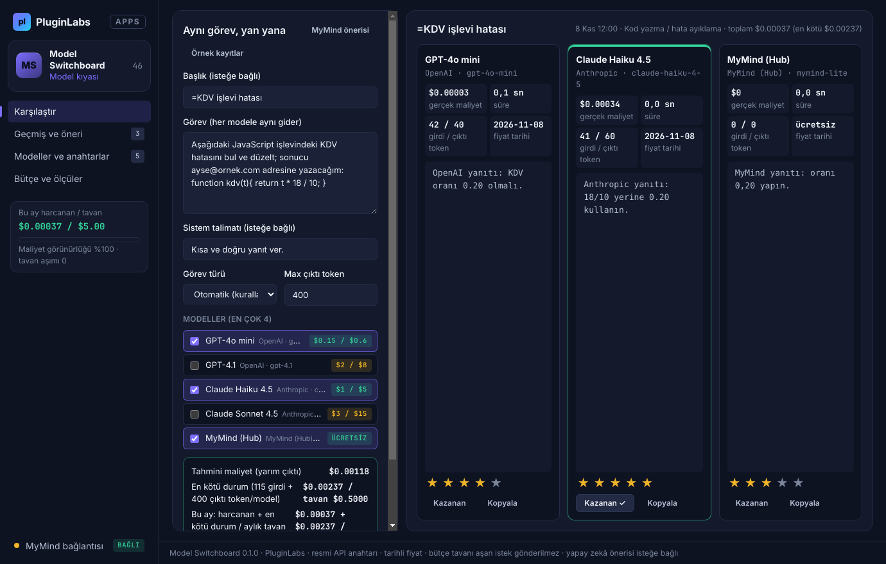
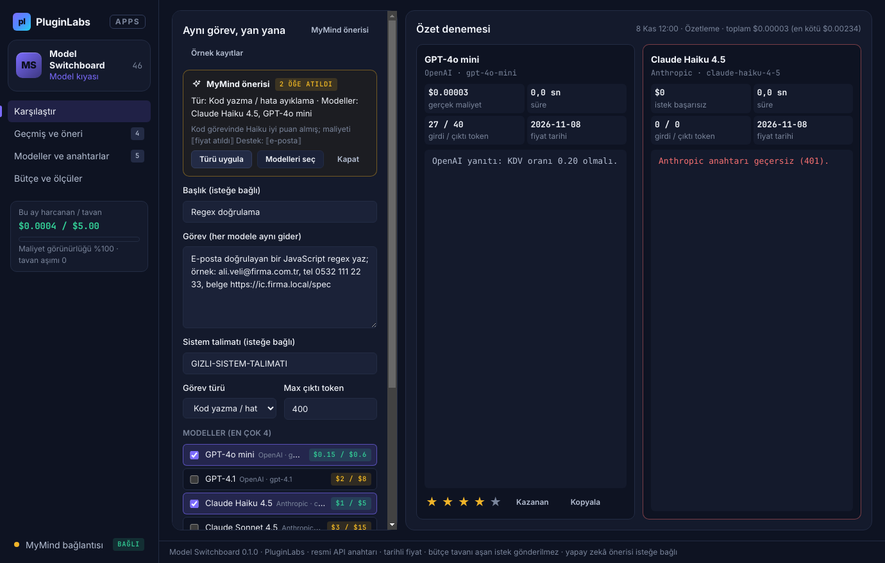
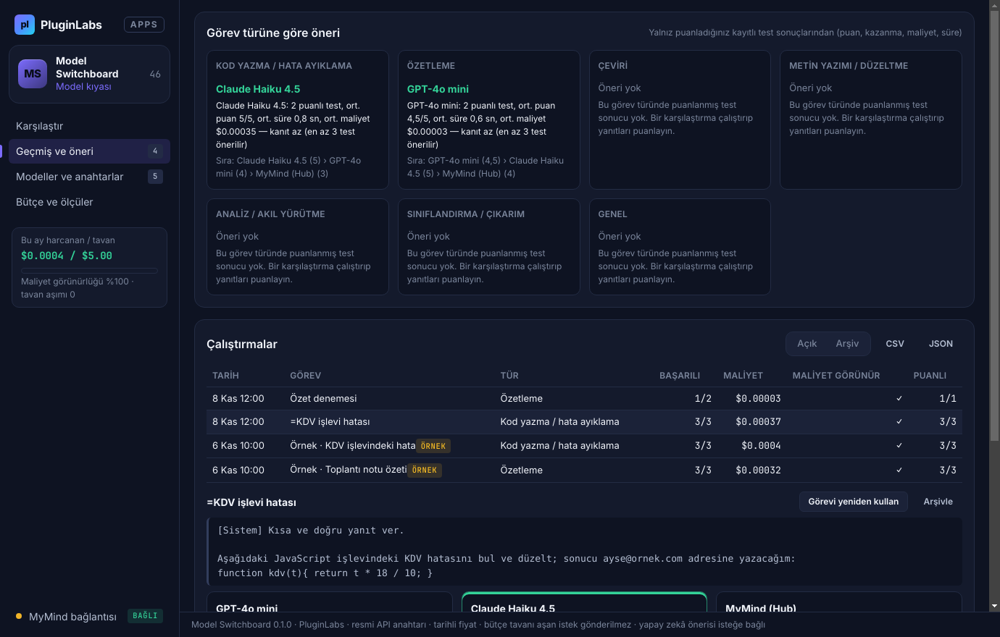
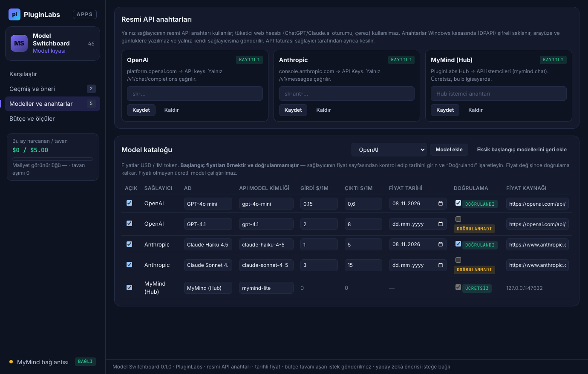
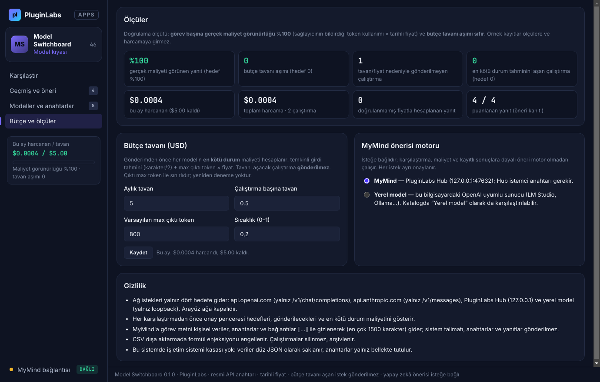

# Model Switchboard (PL-046) — Windows uygulaması

Birden çok model sağlayıcısının **maliyet, anahtar ve çıktılarını** tek panelde karşılaştırın: Model Switchboard **resmi API anahtarınızla** (OpenAI, Anthropic; ayrıca ücretsiz MyMind ve yerel model) aynı görevi **yan yana** çalıştırır; her yanıtın **süresini, token kullanımını ve gerçek maliyetini** gösterir. Fiyatlar katalogda **tarihli** tutulur; **bütçe tavanını aşacak istek gönderilmez**. Puanladığınız sonuçlar, görev türüne göre **kanıtlı model önerisine** dönüşür.

> Ürün deposu henüz yok; kaynak bu klasördedir (PluginLabs ürün ön geliştirme alanı, PL-025 modeli). Windows paketleri `pluginlabs-dagitim` deposunda `model-switchboard-v<sürüm>` etiketiyle yayımlanır.



| MyMind önerisi (uydurma model ve fiyat atıldı) | Geçmiş ve görev türüne göre öneri |
| --- | --- |
|  |  |
| **Modeller ve anahtarlar (tarihli fiyat, doğrulama)** | **Bütçe ve ölçüler** |
|  |  |

Ekran görüntüleri gerçek uygulamadan, duman testinin test verisiyle (**taklit OpenAI, Anthropic ve MyMind sunucuları**; uydurma görevler; tarih 8 Kasım 2026'ya sabitlenmiş) Linux/xvfb'de alınmıştır. Windows runner'ında alınan gerçek pencere görüntüleri (`windows-masaustu-*`) release ekindedir.

## İndir
[model-switchboard-v0.1.0](https://github.com/timdesigners-pixel/pluginlabs-dagitim/releases/tag/model-switchboard-v0.1.0) — `ModelSwitchboard-0.1.0-Windows-x64.exe` (kurulum), `ModelSwitchboard-0.1.0-Windows-Portable-x64.exe` (taşınabilir), SHA256SUMS + BUILD-INFO. İmzasız önizleme. PluginLabs Hub kataloğundan da kurulabilir (Hub kataloğu birleşip yayımlanınca).

## Kullanım
1. **Modeller ve anahtarlar**: OpenAI ve/veya Anthropic **resmi API anahtarınızı** girin (Windows kasasında şifreli). Katalogdaki fiyatları sağlayıcının fiyat sayfasından kontrol edip **tarihini** girin ve **Doğrulandı** işaretleyin (başlangıç fiyatları örnektir).
2. **Bütçe ve ölçüler**: aylık ve çalıştırma başına tavanı (USD) ve varsayılan max çıktı tokenını ayarlayın.
3. **Karşılaştır**: görevi yazın, 1–4 model seçin. Altta tahmini ve **en kötü durum** maliyeti ile ay içindeki harcama görünür; tavanı aşacaksa neden yazılır ve gönderim yapılmaz. **Karşılaştır** → onay penceresi → yanıtlar yan yana.
4. Yanıtları **puanlayın** / **kazanan** seçin. **Geçmiş ve öneri**: görev türüne göre öneri (kanıt sayısıyla), çalıştırmalar, CSV/JSON.
5. İsteğe bağlı **MyMind önerisi**: görev türü ve katalogdan model önerisi (onaylı, kişisel veriler gizlenir).

## Maliyet ve bütçe kuralları
- **Gerçek maliyet** = sağlayıcının yanıtta bildirdiği token kullanımı × katalog fiyatı (o anki fiyat ve tarihi sonuçla saklanır). Kullanım bildirilmezse maliyet **"görünmüyor"** olarak işaretlenir, tahmin yazılmaz.
- **En kötü durum** = temkinli girdi tahmini (karakter/2 + 32) + max çıktı token, fiyatla çarpılır. Çalıştırma toplamı çalıştırma tavanını, bu ayki harcama + toplam aylık tavanı aşarsa **istek gönderilmez**.
- Çıktı `max_completion_tokens` (OpenAI) / `max_tokens` (Anthropic) ile sınırlanır; yeniden deneme yoktur. MyMind ve yerel model ücretsizdir (0 USD).

## Güvenlik ve gizlilik
- Ağ erişimi yalnız `desktop/net.js` içinde ve yalnız dört hedefe: `https://api.openai.com/v1/chat/completions`, `https://api.anthropic.com/v1/messages`, PluginLabs Hub (127.0.0.1:47632) ve loopback yerel model. Başka yol reddedilir; yönlendirme izlenmez; `credentials: omit`.
- Anahtarlar Windows kasasında (DPAPI); arayüze, duruma, günlüklere ve dışa aktarmaya verilmez. Kasa yoksa yalnız bellekte tutulur.
- Arayüz CSP ile ağa kapalıdır (`connect-src 'none'`), metin yalnız `textContent`/`value` ile yazılır; `contextIsolation` + `sandbox`; IPC yalnız uygulamanın kendi penceresinden; izin istekleri reddedilir.
- MyMind'a görev metni kişisel veriler/anahtarlar/bağlantılar ⟦…⟧ ile gizlenerek (≤1500 karakter) gider; sistem talimatı ve yanıtlar gitmez. Görev metnindeki talimatlar veri sayılır.
- Silme yok: çalıştırmalar arşivlenir. CSV'de formül enjeksiyonu engellenir.

## Geliştirme
```bash
npm ci
npm test                                   # çekirdek birim testleri (node:test)
PLAYWRIGHT_MODULE=playwright xvfb-run -a -s "-screen 0 1440x900x24" node tests/desktop-smoke.cjs docs/screenshots
npm run build:win                          # Windows: kurulum + taşınabilir
node scripts/make-icons.cjs                # simgeleri yeniden üret
```
Windows derlemesi `ci/pluginlabs-dagitim-model-switchboard-windows.yml` iş akışıyla `pluginlabs-dagitim` deposunda, sabit bir PluginLabs commit'inden yapılır.
