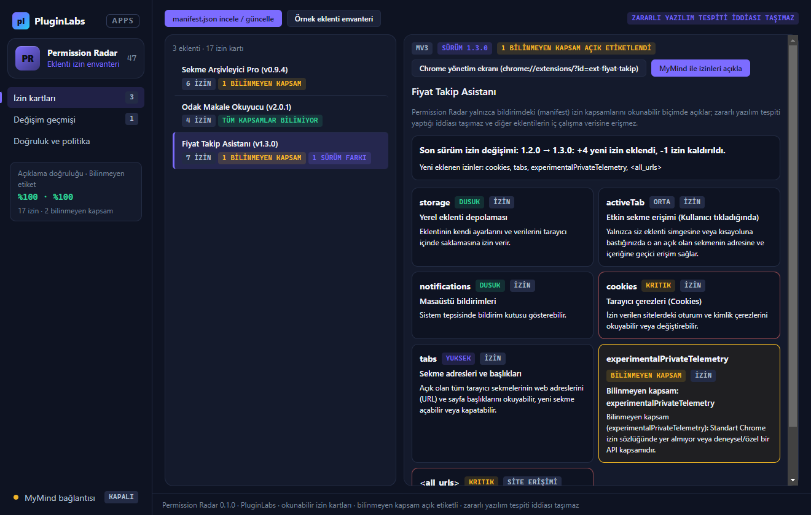

# PL-047 · Permission Radar

> Tarayıcı eklentilerinin izinlerini okunabilir bir envantere dönüştürür ve izin değişikliklerini gösterir.

| Alan | Değer |
| --- | --- |
| Kimlik | `PL-047` · `permission-radar` |
| Kategori | 05 · Geliştirici ve profesyonel araçlar — PL-041–050 |
| Durum | 07.11.2026: **0.1.0 Windows uygulaması hazır** — [permission-radar-v0.1.0](https://github.com/timdesigners-pixel/pluginlabs-dagitim/releases/tag/permission-radar-v0.1.0) (`pluginlabs-dagitim`, Windows runner: test + duman testi + SHA256 + BUILD-INFO + Windows ekran görüntüleri); kaynak [app/](app/README.md) · Notion durumu: Yeni fikir |
| Öncelik / efor | P2 · M |
| Hedef platformlar | Windows, Linux, macOS, Chrome |
| Dağıtım biçimi | masaüstü uygulaması, Chrome eklentisi (Manifest V3) |
| Geliştirme deposu | Henüz yok — kaynak bu klasörün [`app/`](app/README.md) alt klasöründe (ön geliştirme alanı; bkz. [repo hiyerarşisi](../../../docs/REPO-HIYERARSISI.md)); Windows derlemesi ve sürüm dosyaları `pluginlabs-dagitim` deposunda (iş akışı: [`app/ci/`](app/ci/pluginlabs-dagitim-permission-radar-windows.yml)) |
| Codex projesi | `PL-047 · Permission Radar` — ikinci klasör: PluginLabs |
| Notion kaynağı | [Notion](https://app.notion.com/p/4038aa13d8f981059dfad209ce1240d1) |

## Ne işe yarar

**Kullanıcı ve problem:** Kurduğu eklentilerin hangi sitelere eriştiğini anlamayan kullanıcılar.

**Kısa tanım (Hub kataloğu):** Tarayıcı eklentilerinin izinlerini okunabilir bir envantere dönüştürür ve izin değişikliklerini gösterir.

## Hangi platformlar için yayınlanır

**Notion’daki platform tanımı:** Chrome izin envanteri + W / L / M yardımcı panel

- Windows
- Linux
- macOS
- Chrome

> Platformlar hedef kapsamdır. PluginLabs ürün ilkesi gereği test edilmemiş platform “destekleniyor” diye etiketlenmez; her platform gerçek cihaz/tarayıcı kabulünden sonra yayın listesine girer.

## Özellikler

### MVP ve temel akış

İzin verildiğinde eklenti izinlerini okunabilir kartlara dönüştür; değişim geçmişi ve Chrome’un yönetim ekranına yönlendirme.

### Yapay zekânın rolü

İzinlerin ne anlama geldiğini açıklar; zararlı yazılım tespiti yaptığı iddiası taşımaz.

## Teknik bağımlılık ve sınırlar

Chrome management API kapsamı ve kullanıcı izni önce teknik pilotla doğrulanır; diğer eklentilerin iç verisine eriştiği varsayılmaz.

## Gelir hipotezi

Ücretsiz temel şeffaflık; ekip politika raporu ücretli.

## Doğrulama ölçütü

Test eklentilerinde izin açıklamasının doğruluğu; bilinmeyen kapsamın açık etiketlenmesi.

## Öncelik ve efor

P2 · M; API kısıtları nedeniyle ilk hafta yapılabilirlik deneyi.

## 0.1.0 sürümü (Windows)

Notion MVP akışı: **izin verildiğinde eklenti izinlerini okunabilir kartlara dönüştür; değişim geçmişi ve Chrome’un yönetim ekranına yönlendirme.** Eklenti `manifest.json` bildirimlerini (`permissions`, `optional_permissions`, `host_permissions`, `content_scripts`) sade Türkçe izin kartlarına dönüştürür, sürümler arası izin değişim geçmişini (`+` yeni eklenen / `-` kaldırılan izinler) hesaplar ve `chrome://extensions/?id=<kimlik>` yönetim ekranına yönlendirir.

Yapay zekânın rolü ve teknik sınır (Notion): **izinlerin ne anlama geldiğini açıklar; zararlı yazılım tespiti yaptığı iddiası taşımaz; diğer eklentilerin iç verisine eriştiği varsayılmaz.** Doğrulama ölçütü: **test eklentilerinde izin açıklamasının doğruluğu (%100); bilinmeyen kapsamın açık etiketlenmesi (%100).** İsteğe bağlı onaylı MyMind (PluginLabs Hub) ya da yerel model (loopback) açıklamasında olası zararlı yazılım/virüs iddiaları denetimde filtrelenir. Dışa aktarma: CSV envanteri, Markdown ekip politika raporu ve JSON yedek.

Kapsam dışı (bu sürüm): diğer eklentilerin çalışma zamanı iç verisine erişim, zararlı yazılım taraması, Chrome eklentisi paketi, Linux/macOS paketleri. Ayrıntı: [app/README.md](app/README.md).

## Geliştirme ve ortak çalışma (Codex + Claude Code)

- Dal adı: `codex/PL-047-<konu>` veya `claude/PL-047-<konu>`; iki ajan aynı dalda aynı anda çalışmaz.
- İşe başlamadan önce [AKTIF-ISLER.md](../../../docs/ortak-calisma/AKTIF-ISLER.md) tablosuna satır eklenir; iş bitince devir notu yazılır.
- Kurallar: [AGENTS.md](../../../AGENTS.md) (her iki ajan için ortak), protokol: [AI-ORTAK-CALISMA.md](../../../docs/ortak-calisma/AI-ORTAK-CALISMA.md).

## Notion kartının özgün metni

Aşağıdaki metin `resources/notion-catalog.json` (Notion anlık görüntüsü, 2026-10-26) içindeki kartın kısaltılmadan aktarılmış hâlidir.

Tam kartı göster

- **Durum:** Yeni fikir
- **Platform:** Chrome izin envanteri + W / L / M yardımcı panel
- **Kullanıcı ve problem:** Kurduğu eklentilerin hangi sitelere eriştiğini anlamayan kullanıcılar.
- **MVP ve temel akış:** İzin verildiğinde eklenti izinlerini okunabilir kartlara dönüştür; değişim geçmişi ve Chrome’un yönetim ekranına yönlendirme.
- **Yapay zekânın rolü:** İzinlerin ne anlama geldiğini açıklar; zararlı yazılım tespiti yaptığı iddiası taşımaz.
- **Teknik bağımlılık ve sınır:** Chrome management API kapsamı ve kullanıcı izni önce teknik pilotla doğrulanır; diğer eklentilerin iç verisine eriştiği varsayılmaz.
- **Gelir hipotezi:** Ücretsiz temel şeffaflık; ekip politika raporu ücretli.
- **Doğrulama ölçütü:** Test eklentilerinde izin açıklamasının doğruluğu; bilinmeyen kapsamın açık etiketlenmesi.
- **Öncelik ve efor:** P2 · M; API kısıtları nedeniyle ilk hafta yapılabilirlik deneyi.

---
Oluşturma: 29.10.2026 · Kaynak → hedef: Notion kataloğu → `registry/projects.json` → bu dosya
