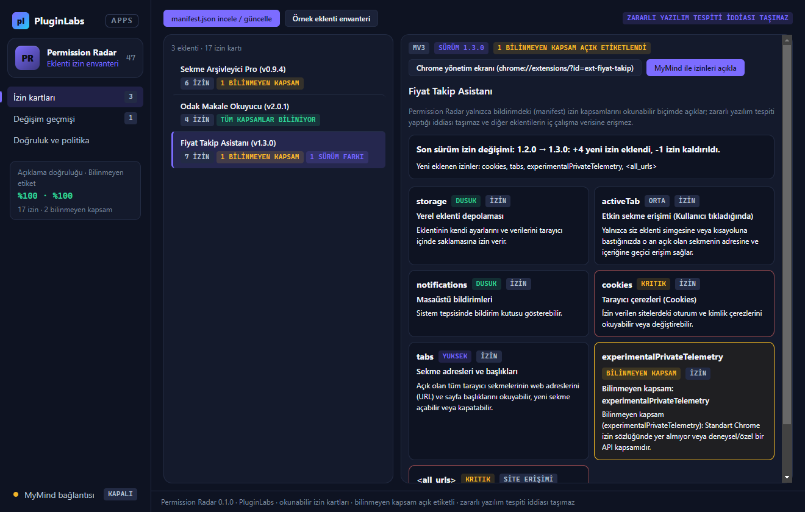
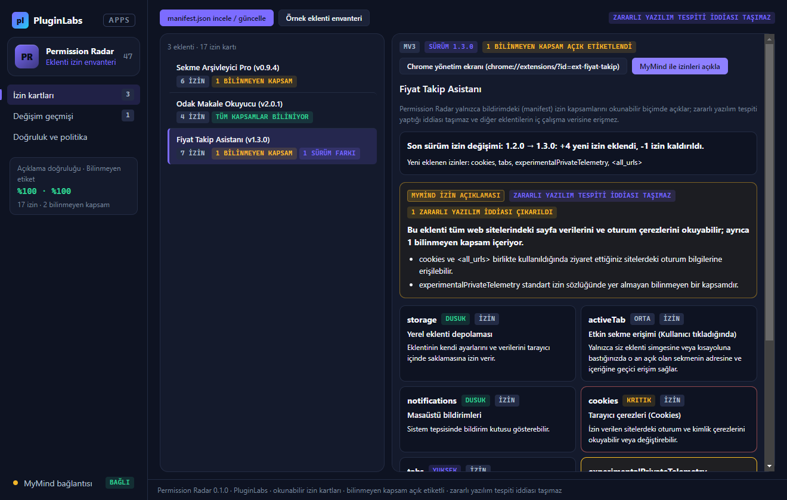
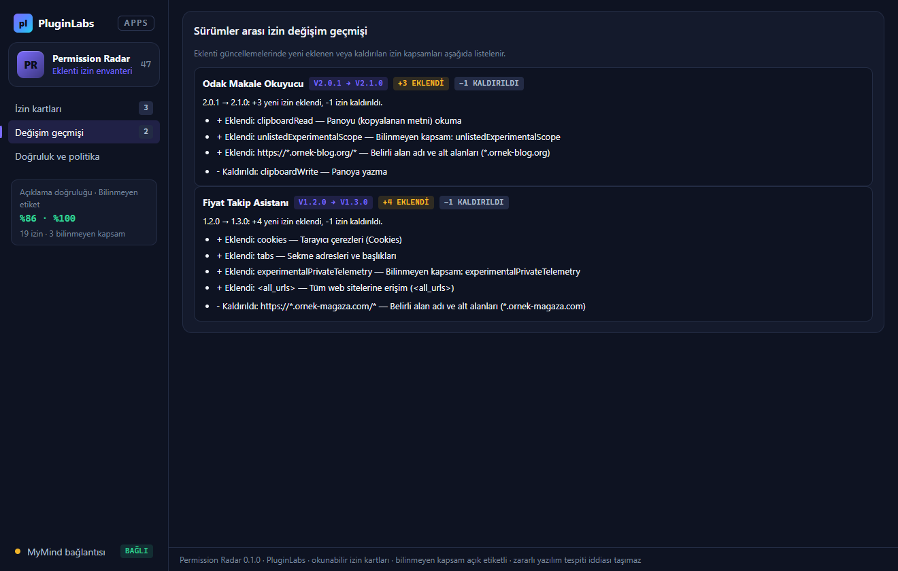
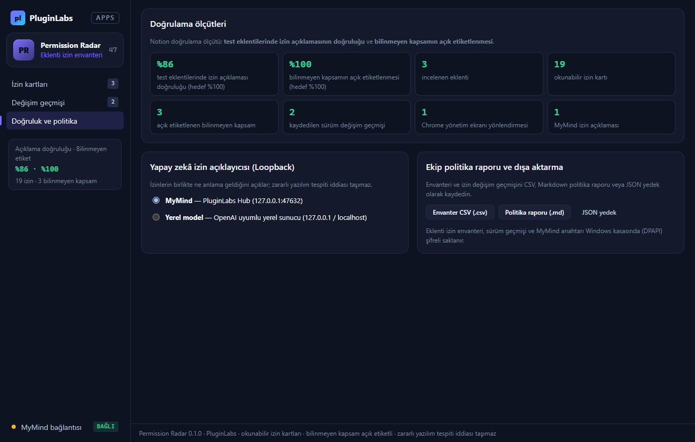
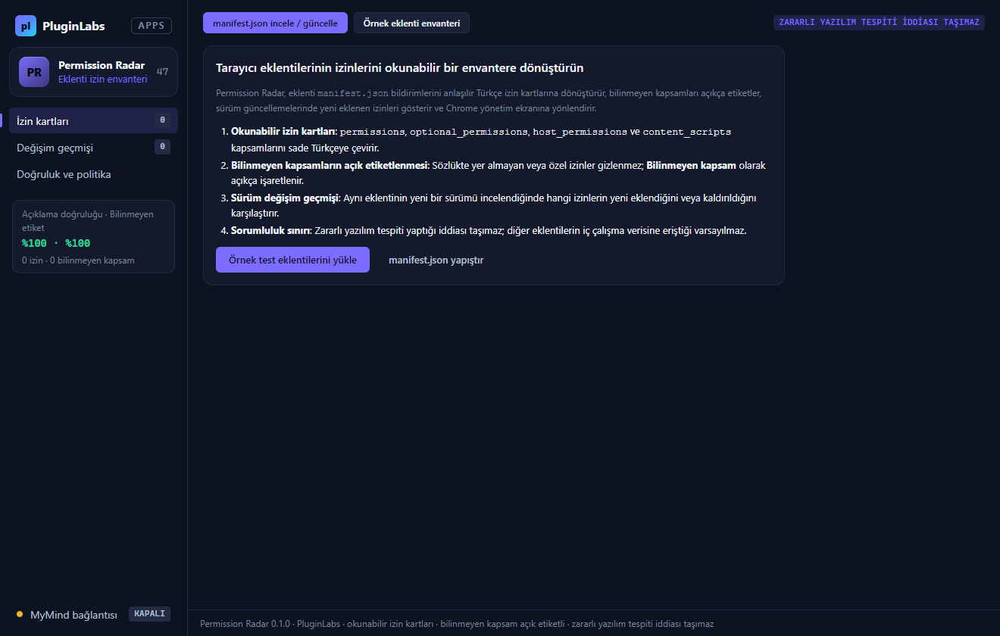

# Permission Radar (PL-047) — Windows uygulaması

Tarayıcı eklentilerinin `manifest.json` bildirimlerini ve izin envanterini **okunabilir Türkçe izin kartlarına** dönüştürün, **bilinmeyen kapsamları açıkça görün** ve sürümler arası **izin değişim geçmişini** takip edin. Permission Radar **zararlı yazılım tespiti yaptığı iddiası taşımaz** ve diğer eklentilerin iç çalışma verisine eriştiği varsayılmaz.

> Ürün deposu henüz yok; kaynak bu klasördedir (PluginLabs ürün ön geliştirme alanı). Windows paketleri `pluginlabs-dagitim` deposunda `permission-radar-v<sürüm>` etiketiyle yayımlanır.



| MyMind izin açıklaması (zararlı yazılım iddiası taşımaz) | Sürümler arası izin değişim geçmişi |
| --- | --- |
|  |  |
| **Doğruluk ölçütleri ve politika raporu** | **Başlangıç** |
|  |  |

## Kullanım
1. **İzin kartları**: İlk deneme için **Örnek eklenti envanteri** düğmesine basın ya da **manifest.json incele / güncelle** penceresine incelemek istediğiniz eklentinin `manifest.json` içeriğini yapıştırın.
2. **Bilinmeyen kapsamların açık etiketlenmesi**: Standart Chrome izin sözlüğünde yer almayan özel veya deneysel kapsamlar gizlenmez; **Bilinmeyen kapsam** rozetiyle açıkça işaretlenir.
3. **Sürüm değişim geçmişi**: Aynı eklenti kimliğiyle yeni bir sürüm incelendiğinde hangi izinlerin yeni eklendiği (`+`) veya kaldırıldığı (`-`) karşılaştırmalı olarak kaydedilir.
4. **Chrome yönetim ekranına yönlendirme**: Seçili eklentinin `chrome://extensions/?id=<kimlik>` adresi tek tıkla kopyalanır.
5. **Politika raporu ve dışa aktarma**: Ekip denetimi için CSV envanteri, Markdown politika raporu ve JSON yedek dışa aktarılır.

## Güvenlik ve gizlilik
- Arayüz CSP ile ağa kapalıdır (`connect-src 'none'`); metin yalnız `textContent`/`value` ile yazılır; `contextIsolation` + `sandbox`.
- Diğer eklentilerin iç çalışma verisine erişilmez; zararlı yazılım veya virüs tespiti yaptığı iddiası taşınmaz.

## Geliştirme
```bash
npm ci
npm test
node tests/desktop-smoke.cjs docs/screenshots
npm run build:win
node scripts/make-icons.cjs
```
