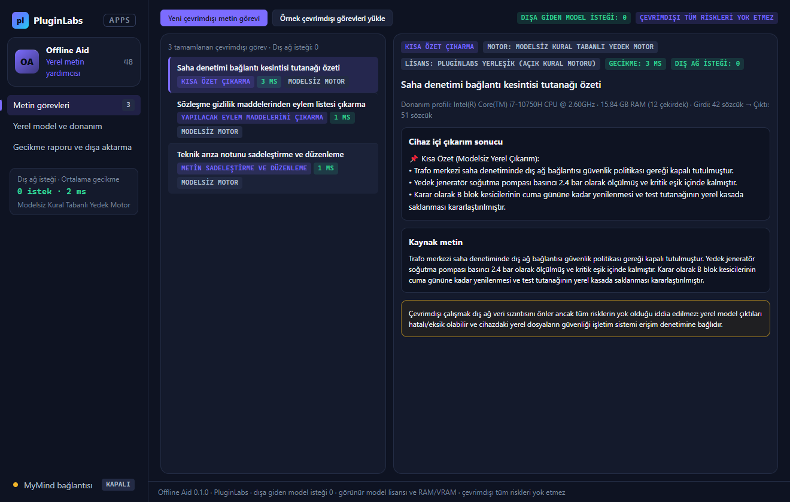

# PL-048 · Offline Aid

> Uyumlu yerel modellerle metin özetleme ve düzenleme işlemlerini cihazda çalıştırır.

| Alan | Değer |
| --- | --- |
| Kimlik | `PL-048` · `offline-aid` |
| Kategori | 05 · Geliştirici ve profesyonel araçlar — PL-041–050 |
| Durum | 08.11.2026: **0.1.0 Windows uygulaması yayımlandı** — [offline-aid-v0.1.0](https://github.com/timdesigners-pixel/pluginlabs-dagitim/releases/tag/offline-aid-v0.1.0) (`pluginlabs-dagitim`, Windows runner: test + duman testi + kurulum/taşınabilir + SHA256 + BUILD-INFO + Windows ekran görüntüleri); kaynak [app/](app/README.md) · Notion durumu: Yeni fikir |
| Öncelik / efor | P2 · L |
| Hedef platformlar | Windows, Linux, macOS, Chrome |
| Dağıtım biçimi | masaüstü uygulaması, Chrome eklentisi (Manifest V3) |
| Geliştirme deposu | Henüz yok — kaynak bu klasörün [`app/`](app/README.md) alt klasöründe (ön geliştirme alanı; bkz. [repo hiyerarşisi](../../../docs/REPO-HIYERARSISI.md)); Windows derlemesi ve sürüm dosyaları `pluginlabs-dagitim` deposunda (iş akışı: [`app/ci/`](app/ci/pluginlabs-dagitim-offline-aid-windows.yml)) |
| Codex projesi | `PL-048 · Offline Aid` — ikinci klasör: PluginLabs |
| Notion kaynağı | [Notion](https://app.notion.com/p/4038aa13d8f981059dfad209ce1240d1) |

## Ne işe yarar

**Kullanıcı ve problem:** Hassas veya bağlantısız ortamda küçük AI görevleri yapmak isteyen kişiler.

**Kısa tanım (Hub kataloğu):** Uyumlu yerel modellerle metin özetleme ve düzenleme işlemlerini cihazda çalıştırır.

## Hangi platformlar için yayınlanır

**Notion’daki platform tanımı:** W / L / M yerel yardımcı + Chrome seçili içerik

- Windows
- Linux
- macOS
- Chrome

> Platformlar hedef kapsamdır. PluginLabs ürün ilkesi gereği test edilmemiş platform “destekleniyor” diye etiketlenmez; her platform gerçek cihaz/tarayıcı kabulünden sonra yayın listesine girer.

## Özellikler

### MVP ve temel akış

Uyumlu yerel model seçimi, cihaz kaynak kontrolü ve metin özetleme/düzenleme. İlk sürüm tek onaylı model ailesi.

### Yapay zekânın rolü

Çıkarımı yerelde yapar; düşük donanımda basit görev ve modelsiz alternatif sunar.

## Teknik bağımlılık ve sınırlar

Model lisansı, RAM/VRAM gereksinimi ve güncelleme kaynağı görünür. Çevrimdışı diye tüm risklerin yok olduğu iddia edilmez.

## Gelir hipotezi

Tek seferlik istemci lisansı; kurumsal dağıtım ve destek.

## Doğrulama ölçütü

Ağsız testte görev tamamlama; dışa giden model isteği sıfır; donanım bazlı gecikme raporu.

## Öncelik ve efor

P2 · L; tüm ürünlerde opsiyonel yerel AI motoru olarak tekrar kullanılabilir.

## 0.1.0 sürümü (Windows)

Notion MVP akışı: **uyumlu yerel model seçimi, cihaz kaynak kontrolü ve metin özetleme/düzenleme. İlk sürüm tek onaylı model ailesi.** Sistemin RAM ve CPU çekirdek durumu taranır; ilk sürümde tek onaylı yerel model ailesi (Qwen 2.5 Instruct GGUF) ve düşük donanım / ağsız ortamlar için yerleşik **modelsiz kural tabanlı yedek motor** sunulur. Kısa özet çıkarma, anahtar madde ayıklama, metin sadeleştirme ve yapılacak eylem maddesi çıkarma görevleri cihazda çalıştırılır.

Yapay zekânın rolü ve teknik sınır (Notion): **çıkarımı yerelde yapar; düşük donanımda basit görev ve modelsiz alternatif sunar. Model lisansı, RAM/VRAM gereksinimi ve güncelleme kaynağı görünür. Çevrimdışı diye tüm risklerin yok olduğu iddia edilmez.** Doğrulama ölçütü: **ağsız testte görev tamamlama; dışa giden model isteği sıfır; donanım bazlı gecikme raporu.** Dış ağ adresleri reddedilir (yalnız `127.0.0.1` / `localhost` loopback kabul edilir), yerel LLM çıkarımından önce hassas veriler (e-posta, telefon, IBAN) maskelenir. Dışa aktarma: TXT çıktı paketi, Markdown donanım gecikme raporu ve JSON yedek.

Kapsam dışı (bu sürüm): tek onaylı model ailesi dışındaki model aileleri, kurumsal filo dağıtımı, Chrome seçili içerik eklentisi, Linux/macOS paketleri. Ayrıntı: [app/README.md](app/README.md).

## Geliştirme ve ortak çalışma (Codex + Claude Code)

- Dal adı: `codex/PL-048-<konu>` veya `claude/PL-048-<konu>`; iki ajan aynı dalda aynı anda çalışmaz.
- İşe başlamadan önce [AKTIF-ISLER.md](../../../docs/ortak-calisma/AKTIF-ISLER.md) tablosuna satır eklenir; iş bitince devir notu yazılır.
- Kurallar: [AGENTS.md](../../../AGENTS.md) (her iki ajan için ortak), protokol: [AI-ORTAK-CALISMA.md](../../../docs/ortak-calisma/AI-ORTAK-CALISMA.md).

## Notion kartının özgün metni

Aşağıdaki metin `resources/notion-catalog.json` (Notion anlık görüntüsü, 2026-10-26) içindeki kartın kısaltılmadan aktarılmış hâlidir.

Tam kartı göster

- **Durum:** Yeni fikir
- **Platform:** W / L / M yerel yardımcı + Chrome seçili içerik
- **Kullanıcı ve problem:** Hassas veya bağlantısız ortamda küçük AI görevleri yapmak isteyen kişiler.
- **MVP ve temel akış:** Uyumlu yerel model seçimi, cihaz kaynak kontrolü ve metin özetleme/düzenleme. İlk sürüm tek onaylı model ailesi.
- **Yapay zekânın rolü:** Çıkarımı yerelde yapar; düşük donanımda basit görev ve modelsiz alternatif sunar.
- **Teknik bağımlılık ve sınır:** Model lisansı, RAM/VRAM gereksinimi ve güncelleme kaynağı görünür. Çevrimdışı diye tüm risklerin yok olduğu iddia edilmez.
- **Gelir hipotezi:** Tek seferlik istemci lisansı; kurumsal dağıtım ve destek.
- **Doğrulama ölçütü:** Ağsız testte görev tamamlama; dışa giden model isteği sıfır; donanım bazlı gecikme raporu.
- **Öncelik ve efor:** P2 · L; tüm ürünlerde opsiyonel yerel AI motoru olarak tekrar kullanılabilir.

---
Oluşturma: 29.10.2026 · Kaynak → hedef: Notion kataloğu → `registry/projects.json` → bu dosya
