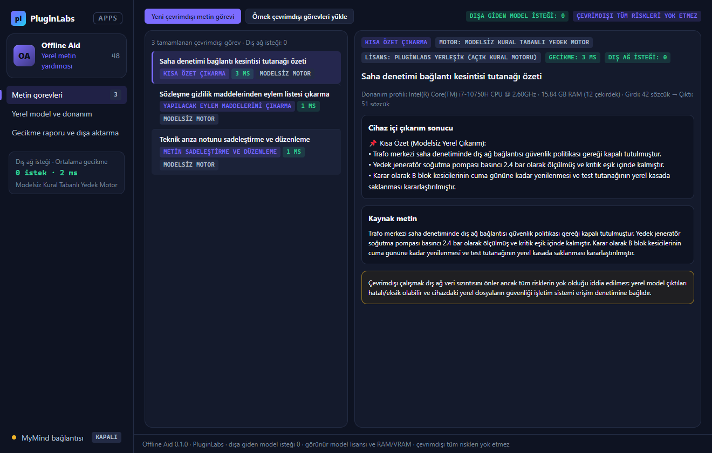
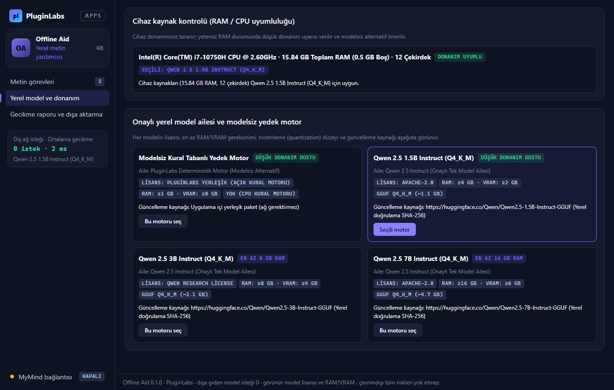
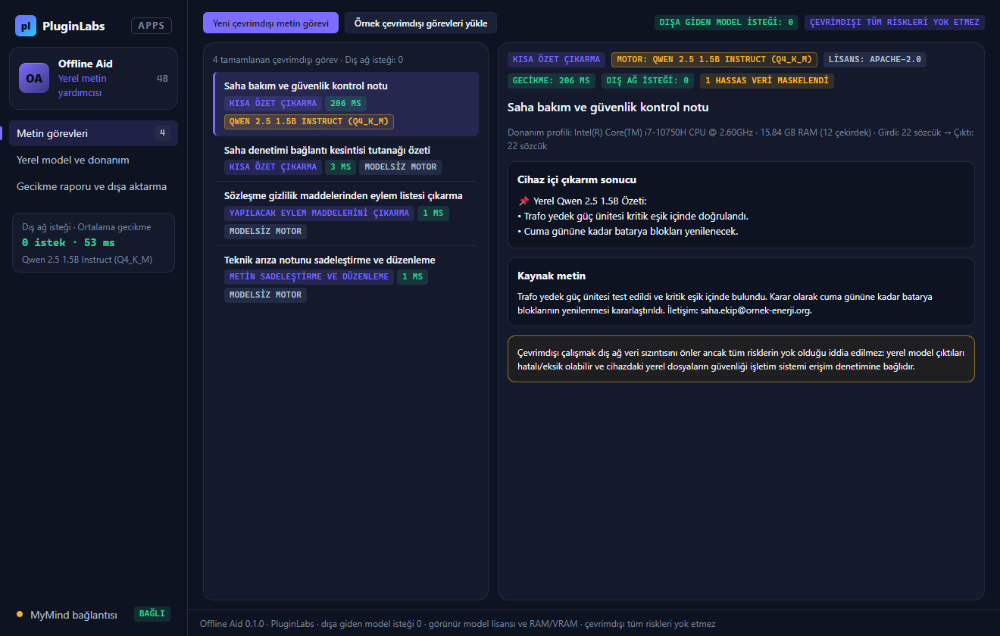
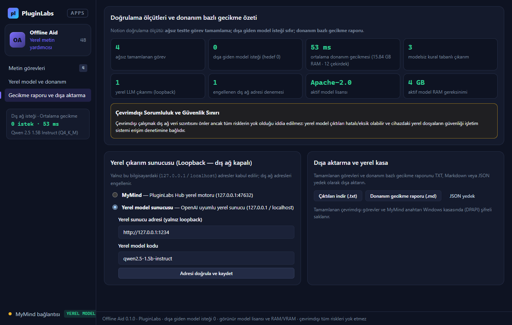
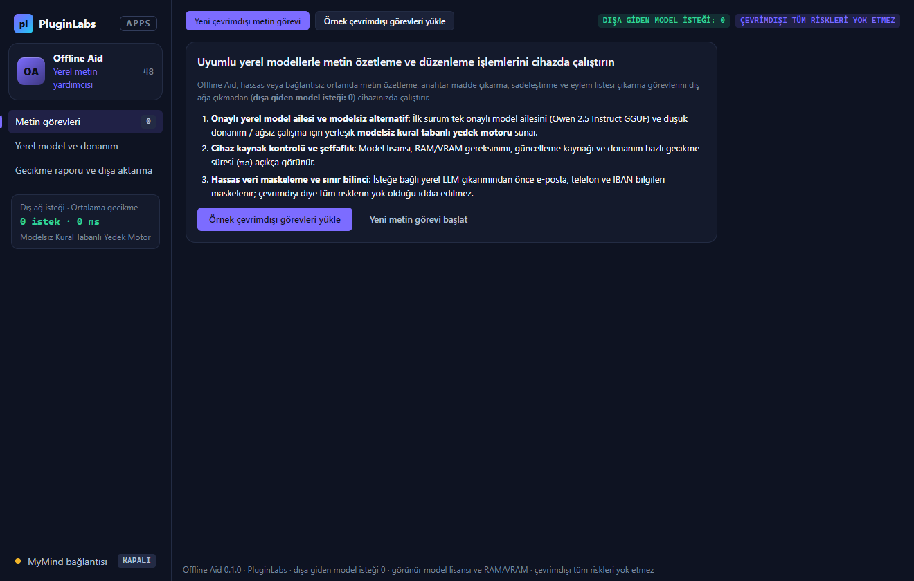

# Offline Aid (PL-048) — Windows uygulaması

Hassas veya bağlantısız ortamda **uyumlu yerel modellerle** ya da düşük donanım için **modelsiz kural tabanlı yedek motorla** metin özetleme, madde çıkarma, sadeleştirme ve eylem maddesi çıkarma işlemlerini cihazınızda çalıştırın (**dışa giden model isteği: 0**). Her modelin **lisansı, RAM/VRAM gereksinimi ve güncelleme kaynağı** görünür; tamamlanan her görev için **donanım bazlı gecikme süresi (`ms`)** raporlanır. **Çevrimdışı diye tüm risklerin yok olduğu iddia edilmez.**

> Ürün deposu henüz yok; kaynak bu klasördedir (PluginLabs ürün ön geliştirme alanı). Windows paketleri `pluginlabs-dagitim` deposunda `offline-aid-v<sürüm>` etiketiyle yayımlanır.



| Onaylı yerel model ailesi ve cihaz kaynak kontrolü | Yerel model çıkarımı ve hassas veri maskeleme |
| --- | --- |
|  |  |
| **Donanım bazlı gecikme raporu ve sınırlar** | **Başlangıç** |
|  |  |

## Kullanım
1. **Ağsız metin görevleri**: İlk deneme için **Örnek çevrimdışı görevleri yükle** veya **Yeni çevrimdışı metin görevi** düğmesiyle özetleme, anahtar madde çıkarma, düzenleme veya eylem maddesi çıkarma işlemini seçin.
2. **Yerel model ve donanım kontrolü**: Cihazınızın RAM ve CPU kaynakları otomatik kontrol edilir; ilk sürüm tek onaylı model ailesini (Qwen 2.5 Instruct GGUF) ve düşük donanım için yerleşik **modelsiz kural tabanlı yedek motoru** sunar.
3. **Görünür model lisansı ve güncelleme kaynağı**: Her modelin lisansı, en az RAM/VRAM gereksinimi, nicemleme düzeyi ve doğrulanabilir güncelleme kaynağı açıkça gösterilir.
4. **Dışa aktarma**: Görev çıktılarını ve donanım bazlı gecikme raporunu `.txt`, `.md` ve JSON yedek olarak dışa aktarın.

## Güvenlik ve gizlilik
- Arayüz CSP ile ağa kapalıdır (`connect-src 'none'`); metin yalnız `textContent`/`value` ile yazılır; `contextIsolation` + `sandbox`.
- Dışa giden model isteği sıfırdır: yalnız bu bilgisayardaki (`127.0.0.1` / `localhost`) yerel çıkarım motoruna izin verilir; dış ağ adresleri engellenir ve sayacı tutulur.
- İsteğe bağlı yerel LLM çıkarımından önce e-posta, telefon ve IBAN bilgileri otomatik maskelenir. Çevrimdışı çalışmak dış ağ sızıntısını önler ancak tüm risklerin yok olduğu iddia edilmez.

## Geliştirme
```bash
npm ci
npm test
node tests/desktop-smoke.cjs docs/screenshots
npm run build:win
node scripts/make-icons.cjs
```
