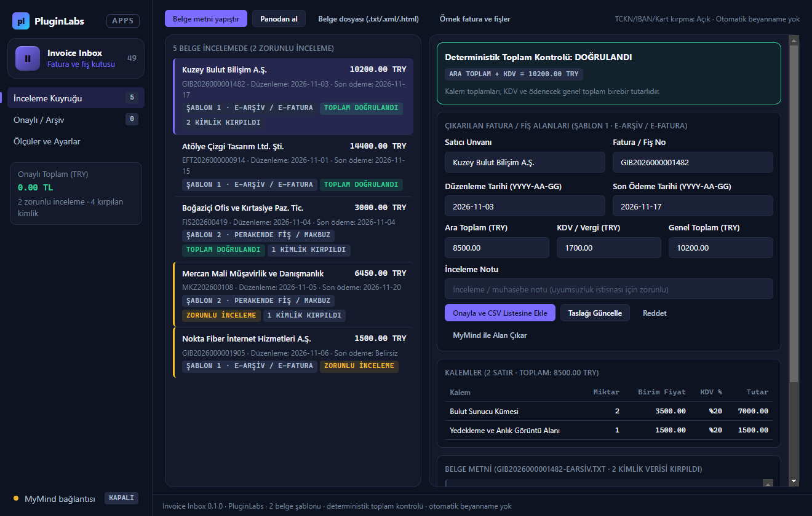
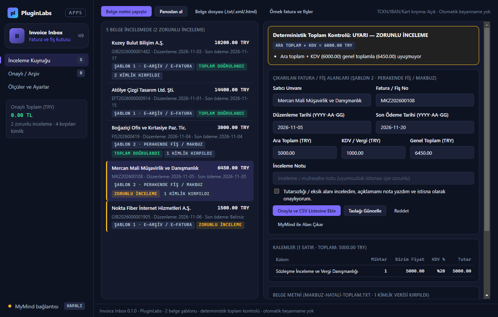
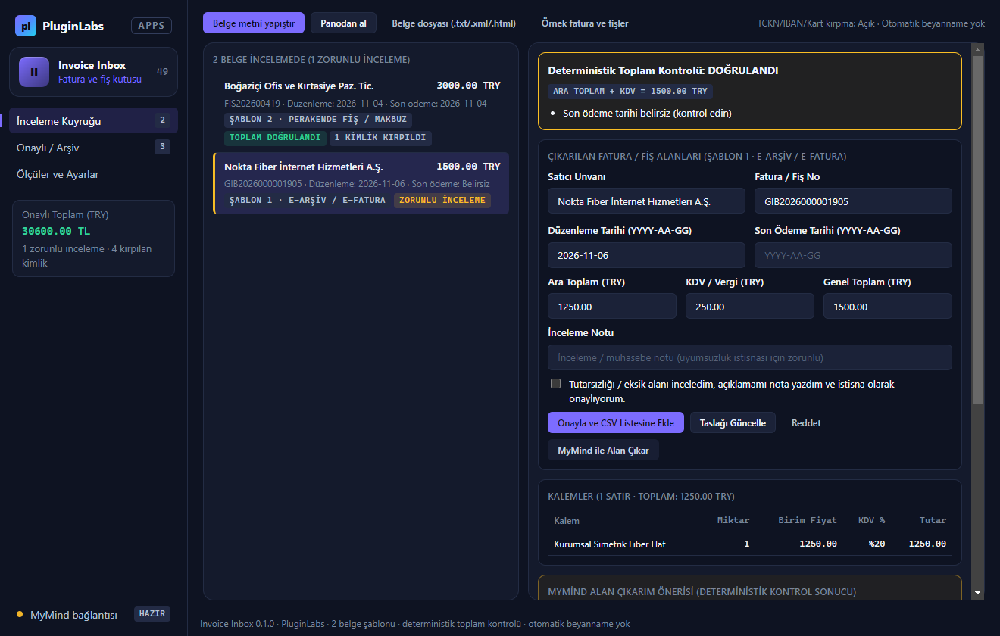
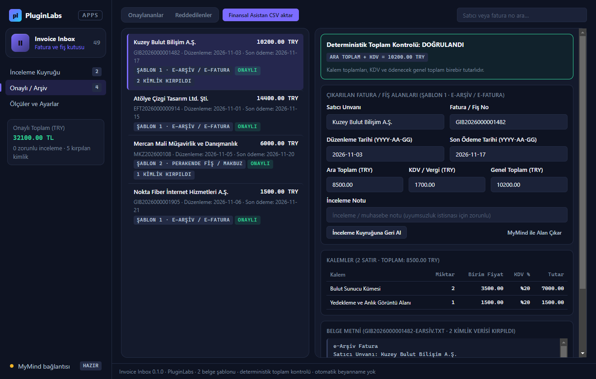
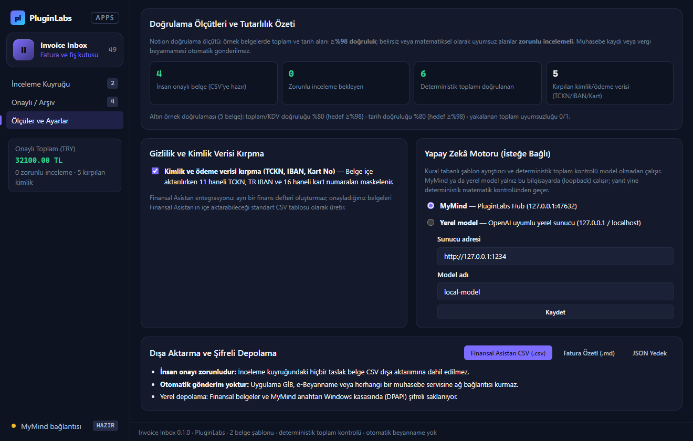

# Invoice Inbox (PL-049) — Windows uygulaması

Yüklenen ve yapıştırılan fatura ile fiş belgelerinden (**Şablon 1: e-Arşiv / UBL-TR e-Fatura**, **Şablon 2: Perakende Fiş / Serbest Meslek Makbuzu**) **satıcı unvanı, fatura/fiş numarası, düzenleme tarihi, son ödeme tarihi, kalemler, KDV ve genel toplamı** çıkarır; `Ara Toplam + KDV = Genel Toplam` ve kalemler toplamı eşitliğini **deterministik hesapla** denetler. Toplamı uyuşmayan veya zorunlu alanı eksik belgeleri **zorunlu insan incelemesine** alır; insan onayı sonrası **Finansal Asistan uyumlu CSV**, Markdown ve JSON olarak dışa aktarır. **Muhasebe kaydı veya vergi beyannamesi otomatik gönderilmez.**

> Ürün deposu henüz yok; kaynak bu klasördedir (`apps/05-gelistirici-ve-profesyonel-araclar/PL-049-invoice-inbox/app`). Windows paketleri `pluginlabs-dagitim` deposunda `invoice-inbox-v<sürüm>` etiketiyle yayımlanır.



| Zorunlu inceleme uyarısı (toplam uyumsuzluğu) | MyMind alan çıkarımı (deterministik denetimli) |
| --- | --- |
|  |  |
| **Onaylı faturalar ve CSV aktarımı** | **Ölçüler ve gizlilik ayarları** |
|  |  |

## Özellikler
- **İki belge şablonu (ilk sürüm):**
  1. **e-Arşiv / e-Fatura (`earsiv-fatura`):** GİB e-Arşiv metin/HTML çıktıları ve UBL-TR XML (`<Invoice>`, `<cbc:ID>`, `<cac:InvoiceLine>`, `<cac:LegalMonetaryTotal>`) belgeleri.
  2. **Perakende Fiş / Serbest Meslek Makbuzu (`serbest-makbuz-fis`):** POS/perakende fişleri ve serbest meslek makbuzları.
- **Deterministik matematik kontrolü:** Kalem satırları toplamının ara toplama ve `Ara Toplam + KDV = Genel Toplam` eşitliğinin kuruş hassasiyetiyle (`±0,02`) uyup uymadığı otomatik denetlenir.
- **Zorunlu inceleme kapısı:** Rakamları uyuşmayan, son ödeme tarihi belirsiz ya da şablonu tanınmayan belgeler kendiliğinden onaylanamaz; kullanıcı rakamı düzeltmeli ya da inceleme notu yazıp istisna onayını işaretlemelidir.
- **Kimlik ve ödeme verisi kırpma:** 11 haneli TCKN (`[TCKN-KIRPILDI]`), TR IBAN (`TR[IBAN-KIRPILDI]`) ve 16 haneli kart numaraları (`[KART-KIRPILDI]`) içe aktarma sırasında isteğe bağlı kırpılır; MyMind / yerel model çağrılarında ise e-posta ve telefon dahil her zaman maskelenir.
- **Finansal Asistan uyumlu dışa aktarma:** Yalnız insan onayından geçmiş (`onayli`) belgeler CSV'ye aktarılır; CSV formül enjeksiyonu (`=`, `+`, `-`, `@`) engellenir. Ayrı bir finans defteri oluşturmaz.
- **Şifreli yerel depolama:** Belgeler ve MyMind istemci anahtarı Windows kasasında (DPAPI `safeStorage`) şifreli saklanır.

## Geliştirme ve Test
```bash
npm test                                   # çekirdek birim testleri (11 test)
node tests/desktop-smoke.cjs docs/screenshots
npm run build:win                          # Windows kurulum + taşınabilir exe
node scripts/make-icons.cjs                # simgeleri yeniden üret
```
