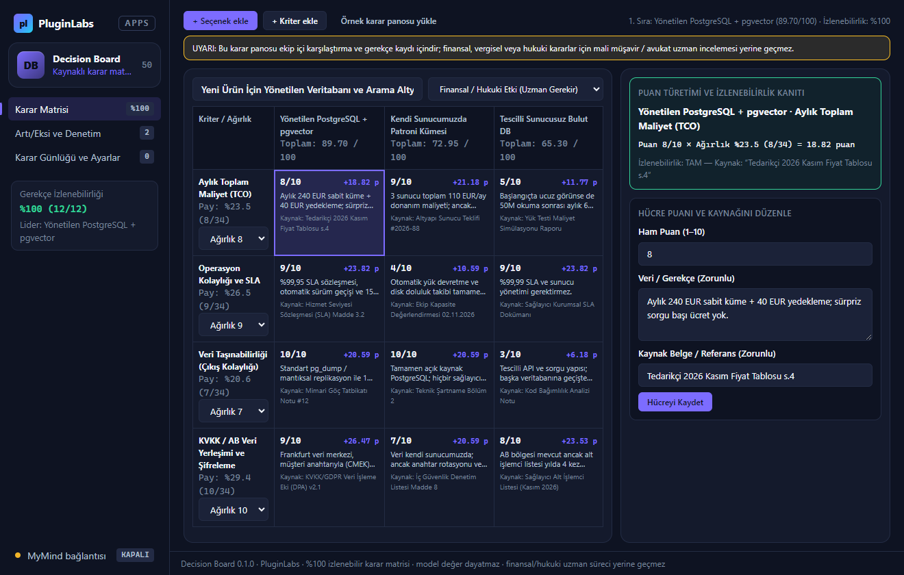

# PL-050 · Decision Board

> Seçenekleri, kriterleri ve ağırlıkları kaynaklı bir karar matrisinde karşılaştırır; karar gerekçelerini saklar.

| Alan | Değer |
| --- | --- |
| Kimlik | `PL-050` · `decision-board` |
| Kategori | 05 · Geliştirici ve profesyonel araçlar — PL-041–050 |
| Durum | 07.11.2026: **0.1.0 Windows uygulaması hazır** — [decision-board-v0.1.0](https://github.com/timdesigners-pixel/pluginlabs-dagitim/releases/tag/decision-board-v0.1.0) (`pluginlabs-dagitim`, Windows runner: test + duman testi + SHA256 + BUILD-INFO + Windows ekran görüntüleri); kaynak [app/](app/README.md) · Notion durumu: Yeni fikir |
| Öncelik / efor | P1 · M |
| Hedef platformlar | Windows, Linux, macOS, Chrome |
| Dağıtım biçimi | masaüstü uygulaması, Chrome eklentisi (Manifest V3) |
| Geliştirme deposu | Henüz yok — kaynak bu klasörün [`app/`](app/README.md) alt klasöründe (ön geliştirme alanı; bkz. [repo hiyerarşisi](../../../docs/REPO-HIYERARSISI.md)); Windows derlemesi ve sürüm dosyaları `pluginlabs-dagitim` deposunda (iş akışı: [`app/ci/`](app/ci/pluginlabs-dagitim-decision-board-windows.yml)) |
| Codex projesi | `PL-050 · Decision Board` — ikinci klasör: PluginLabs |
| Notion kaynağı | [Notion](https://app.notion.com/p/4038aa13d8f981059dfad209ce1240d1) |

## Ne işe yarar

**Kullanıcı ve problem:** Araç, hizmet veya iş kararı için kaynakları ve ölçütleri bir araya getirmek isteyen ekipler.

**Kısa tanım (Hub kataloğu):** Seçenekleri, kriterleri ve ağırlıkları kaynaklı bir karar matrisinde karşılaştırır; karar gerekçelerini saklar.

## Hangi platformlar için yayınlanır

**Notion’daki platform tanımı:** Chrome + W / L / M proje panosu

- Windows
- Linux
- macOS
- Chrome

> Platformlar hedef kapsamdır. PluginLabs ürün ilkesi gereği test edilmemiş platform “destekleniyor” diye etiketlenmez; her platform gerçek cihaz/tarayıcı kabulünden sonra yayın listesine girer.

## Özellikler

### MVP ve temel akış

Kullanıcı seçenek, kriter ve ağırlık girer; kaynaklı karar matrisi, artı/eksi ve karar günlüğü üretir. İlk sürüm manuel kaynaklı tek pano.

### Yapay zekânın rolü

Eksik kriter ve çelişki önerir; kullanıcı tercihleri yerine modelin değerlerini dayatmaz.

## Teknik bağımlılık ve sınırlar

Puanlar hangi veri/ağırlıktan türediğiyle görünür; finansal/hukuki kararlar için uzman süreci yerine geçmez.

## Gelir hipotezi

Ücretsiz bireysel pano; Pro ortak karar alanı ve şablonlar.

## Doğrulama ölçütü

Karar gerekçelerinin %100’ü izlenebilir; haftalık kullanıcı görüşmesinde tekrar kullanım niyeti.

## Öncelik ve efor

P1 · M; Compare Lens veriyi çıkarır, bu ürün ortak karar ve kayıt sürecini yönetir.

## 0.1.0 sürümü (Windows)

Notion MVP akışı: **kullanıcı seçenek, kriter ve ağırlık girer; kaynaklı karar matrisi, artı/eksi ve karar günlüğü üretir. İlk sürüm manuel kaynaklı tek pano.** Her seçenek × kriter hücresinde puanın hangi veri kaynağından, kanıt notundan ve normalize ağırlıktan türediği (`Puan × Normalize Ağırlık`) açıkça gösterilir. Kaynağı veya gerekçesi eksik hücre varsa karar günlüğü kaydı engellenir (**karar gerekçelerinin %100'ü izlenebilir**).

Yapay zekânın rolü ve teknik sınır (Notion): **eksik kriter ve çelişki önerir; kullanıcı tercihleri yerine modelin değerlerini dayatmaz. Puanlar hangi veri/ağırlıktan türediğiyle görünür; finansal/hukuki kararlar için uzman süreci yerine geçmez.** Yerel denetim ve isteğe bağlı onaylı MyMind (PluginLabs Hub) ya da yerel model (loopback) incelemesinde modelin kazanan seçme veya ağırlık değiştirme girişimleri otomatik reddedilir. Dışa aktarma: ADR Markdown karar günlüğü (`.md`), CSV matrisi (formül enjeksiyonu korumalı `.csv`) ve JSON yedek.

Kapsam dışı (bu sürüm): çok kullanıcılı bulut ortak karar alanı (Pro), finansal/hukuki uzman danışmanlığı, Chrome eklentisi, Linux/macOS paketleri. Ayrıntı: [app/README.md](app/README.md).

## Geliştirme ve ortak çalışma (Codex + Claude Code)

- Dal adı: `codex/PL-050-<konu>` veya `claude/PL-050-<konu>`; iki ajan aynı dalda aynı anda çalışmaz.
- İşe başlamadan önce [AKTIF-ISLER.md](../../../docs/ortak-calisma/AKTIF-ISLER.md) tablosuna satır eklenir; iş bitince devir notu yazılır.
- Kurallar: [AGENTS.md](../../../AGENTS.md) (her iki ajan için ortak), protokol: [AI-ORTAK-CALISMA.md](../../../docs/ortak-calisma/AI-ORTAK-CALISMA.md).

## Notion kartının özgün metni

Aşağıdaki metin `resources/notion-catalog.json` (Notion anlık görüntüsü, 2026-10-26) içindeki kartın kısaltılmadan aktarılmış hâlidir.

Tam kartı göster

- **Durum:** Yeni fikir
- **Platform:** Chrome + W / L / M proje panosu
- **Kullanıcı ve problem:** Araç, hizmet veya iş kararı için kaynakları ve ölçütleri bir araya getirmek isteyen ekipler.
- **MVP ve temel akış:** Kullanıcı seçenek, kriter ve ağırlık girer; kaynaklı karar matrisi, artı/eksi ve karar günlüğü üretir. İlk sürüm manuel kaynaklı tek pano.
- **Yapay zekânın rolü:** Eksik kriter ve çelişki önerir; kullanıcı tercihleri yerine modelin değerlerini dayatmaz.
- **Teknik bağımlılık ve sınır:** Puanlar hangi veri/ağırlıktan türediğiyle görünür; finansal/hukuki kararlar için uzman süreci yerine geçmez.
- **Gelir hipotezi:** Ücretsiz bireysel pano; Pro ortak karar alanı ve şablonlar.
- **Doğrulama ölçütü:** Karar gerekçelerinin %100’ü izlenebilir; haftalık kullanıcı görüşmesinde tekrar kullanım niyeti.
- **Öncelik ve efor:** P1 · M; Compare Lens veriyi çıkarır, bu ürün ortak karar ve kayıt sürecini yönetir.

---
Oluşturma: 29.10.2026 · Kaynak → hedef: Notion kataloğu → `registry/projects.json` → bu dosya
