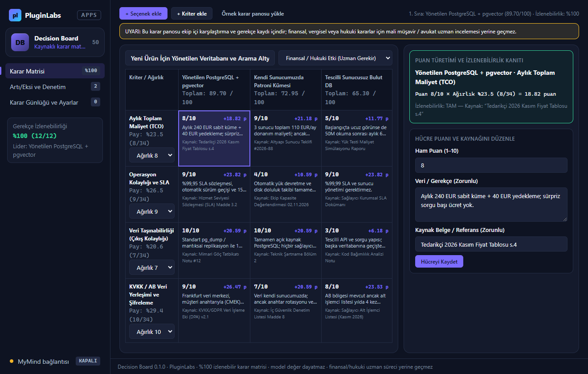
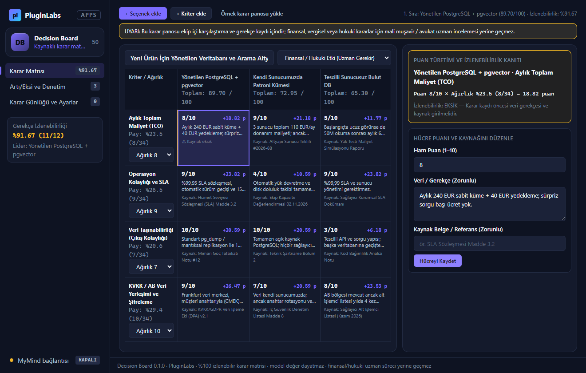
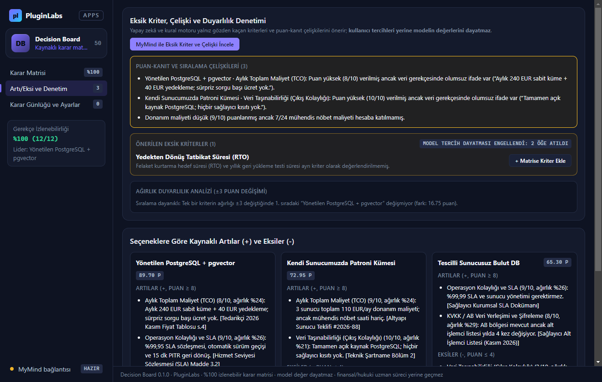
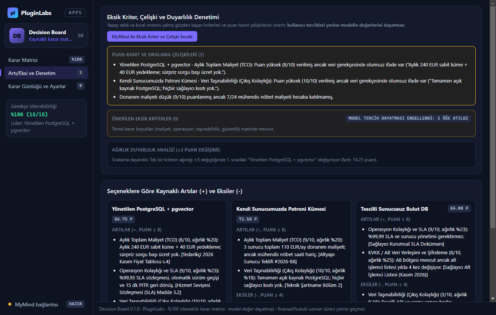
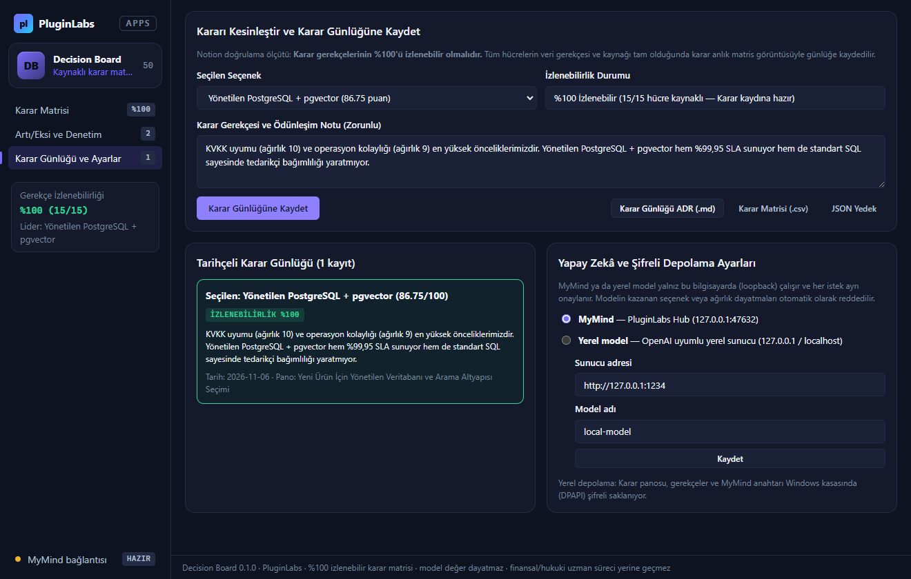

# Decision Board (PL-050) — Windows uygulaması

Seçenekleri, kriterleri ve ağırlıkları **kaynaklı bir karar matrisinde** karşılaştırın, **her puanın hangi veri ve ağırlıktan türediğini (%100 izlenebilirlik)** görün ve karar gerekçelerini tarihçeli bir **karar günlüğünde (ADR)** saklayın. Decision Board **kullanıcı tercihleri yerine modelin değerlerini dayatmaz**; finansal ve hukuki kararlar için **uzman süreci yerine geçmez**.

> Ürün deposu henüz yok; kaynak bu klasördedir (PluginLabs ürün ön geliştirme alanı). Windows paketleri `pluginlabs-dagitim` deposunda `decision-board-v<sürüm>` etiketiyle yayımlanır.



| Kaynaksız hücrede %100 izlenebilirlik kapısı | Artı/eksi listesi ve MyMind eksik kriter/çelişki denetimi |
| --- | --- |
|  |  |
| **Ağırlık duyarlılık analizi ve önerilen kriter ekleme** | **Tarihçeli karar günlüğü (ADR) ve dışa aktarma** |
|  |  |

## Kullanım
1. **Kaynaklı karar matrisi**: İlk deneme için **Örnek karar panosunu yükle** düğmesine basın veya seçenekleri, kriterleri (`1–10` ağırlık) ve hücre puanlarını (`1–10`) kaynak ve kanıt notuyla girin.
2. **Puan türetimi ve %100 izlenebilirlik**: Seçilen her hücrenin ağırlıklı katkısı (`Puan × Normalize Ağırlık`) formülüyle gösterilir. Kaynağı veya gerekçesi eksik hücre varsa karar günlüğü kaydı engellenir (**%100 izlenebilirlik kapısı**).
3. **Artı/eksi, ağırlık duyarlılığı ve çelişki denetimi**: Her seçeneğin güçlü/zayıf yönleri ile ağırlık değişiminde (ör. ±%20) liderin değişip değişmediği hesaplanır. İsteğe bağlı **MyMind** veya **yerel model** (loopback) eksik kriter ve çelişki önerir; modelin kazanan seçme veya ağırlık dayatma girişimleri denetimde reddedilir.
4. **Karar günlüğü (ADR) ve dışa aktarma**: %100 izlenebilir matristen tarihçeli karar kaydı oluşturun; ADR Markdown (`.md`), CSV (`.csv`) ve JSON yedek olarak dışa aktarın.

## Güvenlik ve gizlilik
- Arayüz CSP ile ağa kapalıdır (`connect-src 'none'`); metin yalnız `textContent`/`value` ile yazılır; `contextIsolation` + `sandbox`.
- Karar panosu, karar günlüğü ve MyMind istemci anahtarı Windows kasasında (DPAPI) şifreli saklanır.
- Finansal, vergisel ve hukuki nitelikteki kriterler algılandığında uzman incelemesi uyarısı gösterilir; araç uzman süreci yerine geçmez.

## Geliştirme
```bash
npm ci
npm test
node tests/desktop-smoke.cjs docs/screenshots
npm run build:win
node scripts/make-icons.cjs
```
