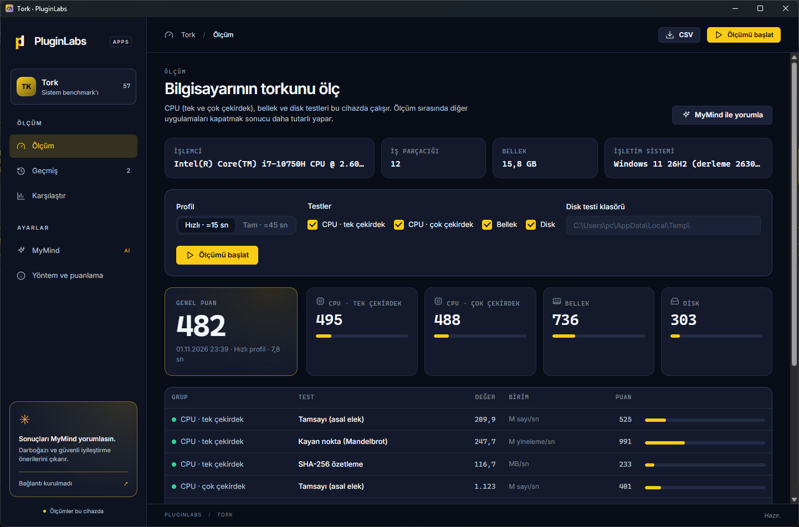
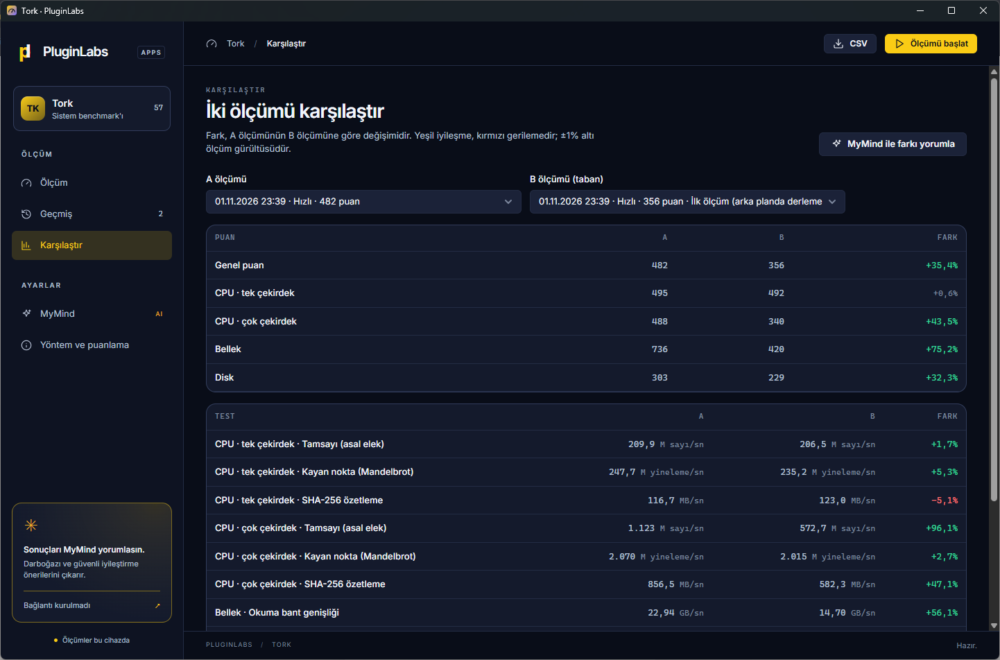

# PL-057 · Tork

> Sistem benchmark'ı: CPU (tek/çok çekirdek), bellek ve disk testleriyle puan verir; ölçüm geçmişi, önce/sonra karşılaştırması, JSON/CSV dışa aktarma ve MyMind ile darboğaz yorumu.

| Alan | Değer |
| --- | --- |
| Kimlik | `PL-057` · `tork` · aksan `#facc15` (`data-pl-product="tork"`) |
| Kategori | 07 · Yeni ürünler — PL-054+ |
| Durum | v0.1.0 geliştirmede · Windows masaüstü (Tauri 2 / Rust) + `tork-cli` (01.11.2026) |
| Öncelik / efor | P2 · M (öneri) |
| Hedef platformlar | Windows; ölçüm motoru ve `tork-cli` Linux'ta da derlenir |
| Dağıtım biçimi | masaüstü uygulaması (kurulum + taşınabilir exe), komut satırı aracı |
| Geliştirme deposu | [timdesigners-pixel/tork](https://github.com/timdesigners-pixel/tork) (özel · kullanıcı onayıyla açılacak; yerel depo `tork`) |
| Hub dağıtımı | Sürüm onayından sonra: `pluginlabs-dagitim` → `tork-v<sürüm>` · `src/catalog.cjs` kaydı `tork` |
| Codex projesi | `PL-057 · Tork` — ikinci klasör: PluginLabs |
| Notion kaynağı | [PL-057 · Tork](https://app.notion.com/p/40b8aa13d8f981d7b221f34a525ed045) |

Gerçek uygulama ekran görüntüleri: Tork 0.1.0 yerel release derlemesi, Windows 11 26H2 · i7-10750H, 01.11.2026. Değerler bu makinedeki iki gerçek hızlı ölçümdür.

## Ne işe yarar

**Kullanıcı ve problem:** Yeni aldığı ya da ayarlarını değiştirdiği bilgisayarın gerçekten hızlanıp hızlanmadığını, darboğazın işlemci, bellek ya da disk olduğunu anlamak isteyen; reklamlı, hesap isteyen ya da veri toplayan benchmark araçlarına güvenmeyen kullanıcılar.

**Kısa tanım (kullanıcı beyanı, 01.11.2026):** “Program listesine, Notion'a ve GitHub'a bir benchmark uygulaması ekle; ismini sen bul, Rust kullanarak yaz.” Ad: **Tork**. PL-056 Notion'da The Ultimate Upscaler'a ait olduğu için PL-057 verildi.

## Özellikler (v0.1.0)

- **12 test, 4 grup:** CPU tek ve çok çekirdek (asal elek, Mandelbrot, SHA-256), bellek (okuma bant genişliği, kopyalama, rastgele erişim gecikmesi), disk (sıralı yazma, önbelleksiz sıralı okuma, rastgele 4K IOPS).
- **Profiller:** Hızlı (≈15 sn) ve Tam (≈45 sn); canlı ilerleme, istenince durdurma.
- **Puanlama:** referans makineye oran (1000 puan), grup ve genel puan geometrik ortalama.
- **Geçmiş:** son 200 ölçüm, not, silme, genel puan grafiği, JSON/CSV dışa aktarma.
- **Karşılaştır:** iki ölçüm test test, yüzde farkla; farklı işlemci/profil uyarısı.
- **MyMind:** Hub üzerinden yorum (özet, darboğaz, ≤4 güvenli öneri); gönderilecek özet önce gösterilir.
- **`tork-cli`:** aynı motor, pencere açmadan; `--json`, `--tam`, `--yalniz`, `--disk`.

## Teknik bağımlılık ve sınırlar

Tauri 2 / Rust çekirdeği, WebView2 arayüzü; ölçüm motoru (`bench.rs`) Tauri'den bağımsızdır. Geçmiş tek JSON dosyasında yalnız bu bilgisayarda. Ağ isteği yalnız MyMind için ve yalnız `127.0.0.1:47632`. Disk testi geçici dosya kullanır ve sonunda siler; okumalar Windows önbelleğini atlar (FILE_FLAG_NO_BUFFERING). MyMind'a bilgisayar adı, kullanıcı adı, dosya yolu ve not gitmez; hız aşırtma/güvenlik ayarı kapatma önerilmez, uygulama hiçbir sistem ayarını değiştirmez.

## Sonraki adımlar (öneri)

- Release (Windows kurulum + taşınabilir, SHA256SUMS, BUILD-INFO, ekran görüntüleri) ve Hub kataloğu.
- GPU testi (wgpu), uzun süreli yük ve ısıl kısılma grafiği.
- PL-052 Tweakster ile “ayar öncesi / sonrası” ölçüm akışı.

## Geliştirme ve ortak çalışma (Codex + Claude Code)

- Dal adı: `codex/PL-057-<konu>` veya `claude/PL-057-<konu>`; iki ajan aynı dalda aynı anda çalışmaz.
- İşe başlamadan önce [AKTIF-ISLER.md](../../../docs/ortak-calisma/AKTIF-ISLER.md) tablosuna satır eklenir; iş bitince devir notu yazılır.
- Kurallar: [AGENTS.md](../../../AGENTS.md) (her iki ajan için ortak), protokol: [AI-ORTAK-CALISMA.md](../../../docs/ortak-calisma/AI-ORTAK-CALISMA.md).

---
Oluşturma: 01.11.2026 · Kaynak → hedef: kullanıcı isteği → `registry/projects.json` → bu dosya
