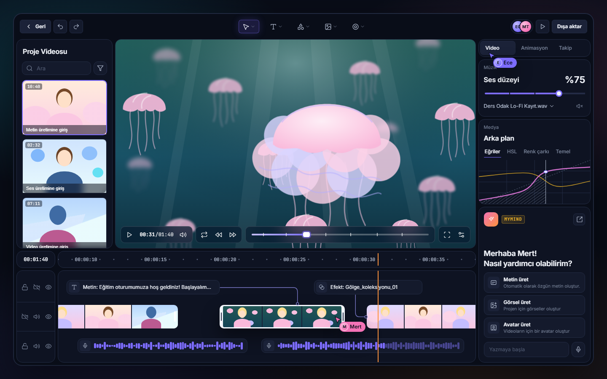
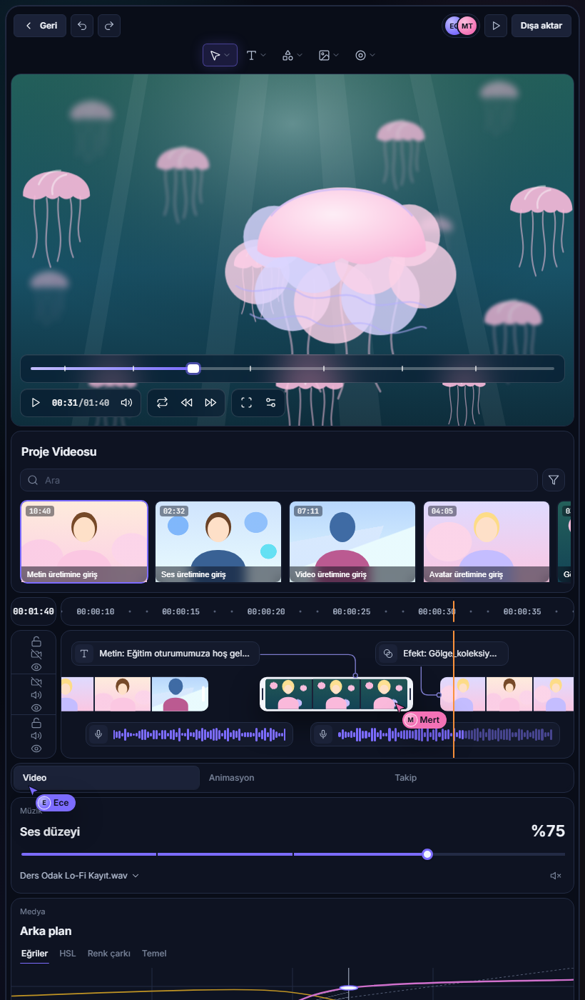

# PL-058 · Kurgu Atölyesi

> Proje videolarını tek ekranda kurgulayan video düzenleyici: önizleme, metin/efekt/video/ses izli zaman çizelgesi, renk düzeltme, ortak çalışma imleçleri ve MyMind ile metin, görsel, avatar üretimi.

| Alan | Değer |
| --- | --- |
| Kimlik | `PL-058` · `kurgu-atolyesi` |
| Kategori | 07 · Yeni ürünler — PL-054+ |
| Durum | Arayüz prototipi (03.11.2026) · masaüstü kabuğu, kurgu motoru ve yayın yok |
| Öncelik / efor | P1 · L |
| Hedef platformlar | Windows, Linux, macOS (masaüstü) |
| Dağıtım biçimi | masaüstü uygulaması (hedef) |
| Geliştirme deposu | Henüz yok — arayüz bu klasörde (`ui/`); ayrı depo kullanıcı onayıyla açılır (bkz. [repo hiyerarşisi](../../../docs/REPO-HIYERARSISI.md)) |
| Codex projesi | `PL-058 · Kurgu Atölyesi` (önerilen ad; henüz oluşturulmadı) |
| Notion kaynağı | Yok — kart açılmadı (kullanıcı isteği, 03.11.2026) |
| Tasarım | PluginLabs Advanced · PLA-095 Video Kurgu Stüdyosu şablonu · `data-pl-product="hub"` |

## Ekran görüntüleri

Gerçek tarayıcı çıktısı (Microsoft Edge headless, Windows 11, 03.11.2026, `ui/index.html`):



<details><summary>Dar ekran (820 px, tek sütun)</summary>



</details>

## Ne işe yarar

**Kullanıcı ve problem:** Eğitim, tanıtım ve sosyal medya videolarını hazırlayan; kliplerini, altyazı/metin katmanlarını, müziği ve renk ayarını farklı araçlar arasında dolaştırmak zorunda kalan içerik üreticileri.

**Kısa tanım (kullanıcı isteği, 03.11.2026):** Referans tasarımdaki (Dribbble, video düzenleme ekranı) tüm öğe ve komponentleri, aynı yerleşimle, PluginLabs Advanced tasarım sistemiyle sunan PluginLabs video düzenleme uygulaması. Planlanan ürünler arasında video düzenleyici bulunmadığı için yeni ürün olarak eklendi (PL-023 Clip Vault bir pano yöneticisidir).

## Arayüz — referanstaki öğelerin karşılıkları

| Bölge | Referanstaki öğe | Bu ekrandaki karşılığı | Komponent |
| --- | --- | --- | --- |
| Üst çubuk | Back · Undo · Redo | Geri · Geri al · Yinele (gerçek geçmiş yığını, Ctrl+Z / Ctrl+Y) | PLC `pl-btn`, `pl-iconbtn` |
| Üst çubuk | Seç / Metin / Şekil / Görsel / Efekt araçları (açılır oklu) | Aynı beş araç; V, T, S, G, E kısayolları | `pl-kurgu-tool` |
| Üst çubuk | İki ortak çalışan avatarı · Oynat · Export | Ece, Mert avatarları · Önizlemeyi oynat · Dışa aktar | PLC-010 `pl-avatars` |
| Sol | Project Video · Search · Filter · süreli kapaklı video listesi | Proje Videosu · Ara · Süzgeç (5 dk altı) · 6 video | PLA-065 türevi |
| Orta | Önizleme + alt oynatma çubuğu (duraklat, süre, sessiz, döngü, geri/ileri sar, segmentli ilerleme, tam ekran, ayar) | Aynı düzen; sürüklenebilir konum çubuğu, klip sınırı işaretleri | PLA-064, `pl-glass` |
| Sağ | Video / Animation / Tracking sekmeleri + “Jane” imleci | Video / Animasyon / Takip + “Ece” imleci | PLC-003 `pl-segment` |
| Sağ | Music · Volume 75% · segmentli kaydırıcı · parça seçici · sessiz | Müzik · Ses düzeyi %75 · parça menüsü · sustur | PLC-023 `pl-slider` |
| Sağ | Media · Background · Curves / HSL / Color Wheel / Basic · taralı eğri grafiği | Medya · Arka plan · Eğriler / HSL / Renk çarkı / Temel; eğri sürüklenerek düzenlenir, metin tablosu var | PLC-030 `pl-tabs` |
| Sağ | Asistan: “Hi Mike! How can I help you?” · Generate Text / Images / Avatar · Start typing + mikrofon | MyMind: “Merhaba Mert!” · Metin / Görsel / Avatar üret · Yazmaya başla + mikrofon | PLC-060/061, MyMind rozeti |
| Alt | 00:01:40 kutusu · noktalı zaman cetveli | Toplam süre · her 5 sn etiket, arada nokta; tıklayınca konuma gider | PLA-063 türevi |
| Alt | İz başlıkları (kilit, video/ses, göz) | 3 iz × 3 düğme, gerçek kilit/gizle/sustur durumu | `pl-iconbtn` |
| Alt | Metin ve efekt klipleri, bağlantı çizgileri, film şeridi klipleri, seçili klip (beyaz çerçeve), dalga formlu ses klipleri, “Mike” imleci | Aynısı; çizgiler klip konumundan hesaplanır, dalga formu oynatmayla dolar, “Mert” imleci | PLA-063, PLA-067 |

Referansta olmayan, tasarım sisteminin zorunlu kıldığı eklemeler: Ctrl/⌘+K komut paleti (PLC-033), oynatma kafası (PLA-063), toast + “Geri al”, AI yanıtlarında “MyMind” rozeti ve kaynak satırı, dar ekran düzeni.

## Klavye

| Tuş | Eylem |
| --- | --- |
| Boşluk · K | Oynat/duraklat · duraklat |
| J · L | 5 sn geri · ileri |
| ← → (Shift ile 5 sn) | 1 sn geri · ileri |
| Home | Başa git |
| M · F | Sesi kapat · tam ekran |
| V T S G E | Araç seçimi |
| Ctrl+Z · Ctrl+Y · Ctrl+E · Ctrl+K | Geri al · yinele · dışa aktar · komut paleti |

## Çalıştırma

```bash
python -m http.server 5755 --bind 127.0.0.1 --directory apps/07-yeni-urunler/PL-058-kurgu-atolyesi/ui
```

Ardından `http://127.0.0.1:5755/` adresini aç. Claude Code masaüstünde `.claude/launch.json` içindeki `kurgu-atolyesi` yapılandırması aynı sunucuyu başlatır.

## Dosyalar

| Yol | İçerik |
| --- | --- |
| `ui/index.html` | Ekran (tek sayfa) |
| `ui/kurgu.css` | Yalnız bu ekrana özgü yerleşim, `pl-kurgu-` önekli, `@layer pl`, sabit renk yok |
| `ui/kurgu.js` | Durum + çizim: oynatma, zaman çizelgesi, iz durumu, eğri, MyMind paneli, komut paleti, geri al/yinele |
| `ui/pl/` | `design-system/pluginlabs-advanced/assets/` kopyası (pl-tokens → pl-components → pl-advanced); değiştirilmez |
| `docs/` | Ekran görüntüleri |

## Bilinen sınırlar (dürüst durum)

- **Gerçek video işleme yok.** Önizleme bir SVG sahne, kapaklar ve film şeridi kareleri tasarım sistemi yer tutucularıdır (referanstaki fotoğraflar telifli olduğu için kopyalanmadı). Dışa aktarma yalnız bildirim gösterir.
- **MyMind bağlı değil.** Asistan yanıtları yerel önizleme yanıtlarıdır ve öyle etiketlenir; gerçek bağlantı Hub üzerinden, onaylı ve veri azaltılmış olmalıdır (MUST HAVE #6).
- **Ortak çalışma imleçleri durağandır** (Ece, Mert); canlı eşleme yok.
- Masaüstü kabuğu (Tauri/Electron), Windows kurulum + taşınabilir exe, Hub kataloğu ve README dışındaki MUST HAVE maddeleri henüz karşılanmadı.
- Yeni ürün aksanı tanımlanmadı; geçici olarak Hub aksanı (`hub`, Iris) kullanılıyor. Kalıcı aksan için tasarım sistemine `data-pl-product="kurgu"` eklenmesi gerekir (opt-in, onay bekliyor).
- Uygulamaya özgü parçalar (ortak çalışma imleci, eğri düzenleyici, film şeridi klibi) şimdilik `pl-kurgu-` önekiyle bu klasörde; sisteme komponent olarak alınmaları onay bekliyor.

## Sonraki adımlar

1. Masaüstü kabuğu ve gerçek medya hattı (dosya içe aktarma, kare önizleme, FFmpeg ile dışa aktarma).
2. Ayrı depo, Windows release (kurulum + taşınabilir + SHA256 + BUILD-INFO) ve Hub kataloğu.
3. MyMind Hub entegrasyonu (onaylı istek, kaynaklı yanıt).
4. Notion kartı ve Codex projesi.
