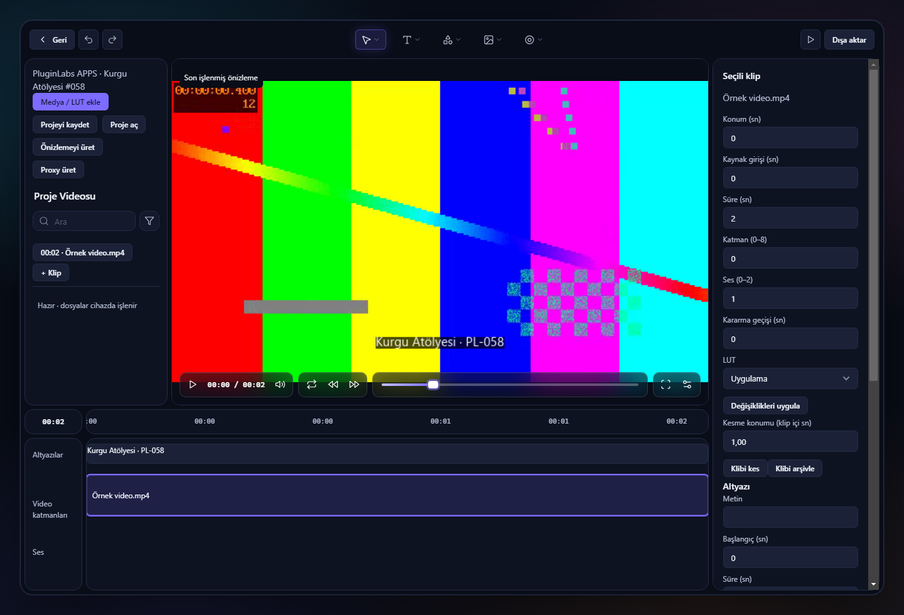

# PL-058 · Kurgu Atölyesi 0.2.0

Gerçek medya işleme için Windows masaüstü önizlemesi. Mevcut Dribbble referansının ana yerleşimi ve PluginLabs Advanced (PLA-095) yüzeyi korunarak yerel FFmpeg hattı bağlandı. Tam ürün kabulü henüz tamamlanmadı.

Kaynak iş: [Notion · KA-01–KA-07](https://app.notion.com/p/40d8aa13d8f980569c47ddaf88ddaaa4). Gardrop PL-055, Kurgu Atölyesi PL-058, MyMind AI PL-059'dur.

## Gerçek ekranlar

04.11.2026, Windows 11 x64: görünmeyen gerçek Electron penceresi. Görüntüdeki renkler FFmpeg ile üretilmiş test videosudur; uygulamanın render ettiği altyazı dahil gerçek video karesidir.



[1440 px headless Edge](docs/studio-1440.png) · [820 px](docs/studio-820.png). Önceki 03.11 prototip görüntüleri tarihsel olup mevcut motorun kanıtı değildir; eski README `_arsiv/04.11.2026/` altında saklıdır.

## Çalışan akış

1. **Medya / LUT ekle** ile video, ses veya `.cube` içe aktar. Kaynak değiştirilmez; uygulamanın proje alanına kopyalanır. Dosya sınırı 1 GB.
2. Zaman çizelgesinden klip seç. Konum, kaynak girişi, süre, katman, ses ve kararma süresini düzenle; **Değişiklikleri uygula**. **Klibi kes** mevcut klibi ikiye ayırır. Undo/redo vardır.
3. Altyazı metni ve zamanını ekle. LUT seçimi klibe uygulanır. Üst video katmanı, alttaki katmanın üstüne bindirilir; boş alan siyahtır.
4. **Önizlemeyi üret** tüm düzenlemelerin 640×360 CPU sonucunu üretir. Kaynağa doğrudan bakmak LUT uygulanmış çıktı değildir; önizleme etiketi bunu ayırır. Aynı FFmpeg grafiği 1920×1080 dışa aktarımda kullanılır.
5. **Proxy üret**, seçili kaynak video için 360p kopya üretir. Sonraki kaynak önizlemeleri proxy'yi kullanır; dışa aktarım orijinal medyayı kullanır. Bu sürümde bir kaynak/proje render'ı en fazla 60 dakikadır.
6. **Dışa aktar** → render kuyruğu → **MP4 indir**. Kuyruk sıralıdır; ilerleme ve iptal desteklenir. Otomatik kayıt klipleri, altyazıları, medya kataloğunu ve biten işleri geri yükler. Yarım kalan işler yeniden açılışta anlaşılır hata gösterir.

Proje JSON'u indir/aç aynı uygulama veri alanındaki medya kimliklerini taşır; taşınabilir medya paketi değildir. Başka bilgisayarda medya da taşınmadan açılması desteklenmez. Kaynaklar ve render çıktıları uygulama veri alanında tutulur; otomatik silinmez.

## Çalıştırma ve paket

Gerekli: Node 24; PATH'te **FFmpeg ve FFprobe** (Windows'ta 9.0.2 ile test edildi). Alternatif `KURGU_FFMPEG` / `KURGU_FFPROBE` tam yolları. Paketler bu araçları içermez; son kullanıcı dağıtımı için codec lisansı/sağlayıcı paketi incelemesi gereklidir.

```powershell
node src/server.cjs
# http://127.0.0.1:5758
```

Electron için mevcut aile araç zinciriyle `electron .` kullanılır. Bu ürün ek npm runtime paketi kullanmaz. `dist/` içinde Windows kurulum ve taşınabilir exe, SHA256SUMS.txt, BUILD-INFO.json ve ekranlar hazırlanır; binary'ler git'e girmez. Paketler imzasız önizlemedir; otomatik yayın/kurulum yapılmadı.

`KURGU_HUB_TOKEN` yalnız backend ortamından okunur. `KURGU_HUB_URL` yalnız HTTP loopback kabul eder. MyMind formundaki açık onayla yalnız yazılan metin `/v1/chat/completions` üzerinden Hub'a gider; video/proje bilgisi gönderilmez. Hub yetkilendirmesi olmadan özellik hata verir. **Canlı Hub/model kabulü yapılmadı**; AI maske, avatar veya görsel üretimi varmış gibi gösterilmez.

## Kapsam ve kabul

| İş | Kanıt / açık sınır |
|---|---|
| KA-01 | Gerçek import, proje modeli, atomik otomatik kayıt, FFmpeg export; test edildi |
| KA-02 | Katman, sayısal trim/konum, kesme, ses miksleme, kararma ve altyazı; sürükleme/ripple ve klipler arası çapraz geçiş açık |
| KA-03 | .cube doğrulama ve render; renk değiştiren LUT ile önizleme/1080p çıktı piksel karşılaştırması geçti |
| KA-04 | Açık: segmentasyon modeli, takip ve elle maske düzeltmesi henüz yok |
| KA-05 | Gerçek kaynak proxy ve seri render kuyruğu; GPU hızlandırma açık |
| KA-06 | Advanced arayüz ve onaylı Hub metin köprüsü; canlı Hub testi ve tam orijinal sağ panel bileşenlerinin işlevsel uyarlaması açık |
| KA-07 | [Düğüm/SDK şartnamesi](docs/KA-07-PRD.md) hazır; düğüm motoru sonraki faz |

## Test kanıtı

- `node --test test/engine.test.cjs`: 3/3; gerçek 1080p/ses/süre, LUT renk eşleşmesi, proxy, kayıt, token/origin/path/range kontrolleri.
- `node test/ui.cjs`: headless Edge'de import → kes → altyazı → render → oynat → yeniden aç; Ctrl+K, 820/1440 px; konsol hatası yok.
- `node test/native.cjs`: gizli gerçek Windows Electron uygulaması; paketlenmiş exe ile de çalıştırıldı.
- Hub `npm test`: 33/33. Hub'ın kendi renderer dosyaları değişmedi; ürün UI testi yukarıdaki ayrı testtir.

Kurulum sihirbazı, DPI/ekran okuyucu, Linux/macOS, gerçek Hub modeli ve GPU render test edilmedi. Elektron sürümü mevcut aile araç zincirinden 33.2.1 olarak kullanıldı; güvenlik yükseltmesi bu işin kapsamında yapılmadı. Yerel paket son kullanıcı yayını değildir.

Hub ortak dosyaları yerine [Hub teslim belgesi](docs/HUB-HANDOFF.md) hazırlandı. Ürün bağımsız deposu, logo/ikon paketi, Hub'dan kurulum, dağıtım ve Hub sürüm yayını açık. [Devir notu](DEVIR.md) kalan işleri ayrıntılandırır.