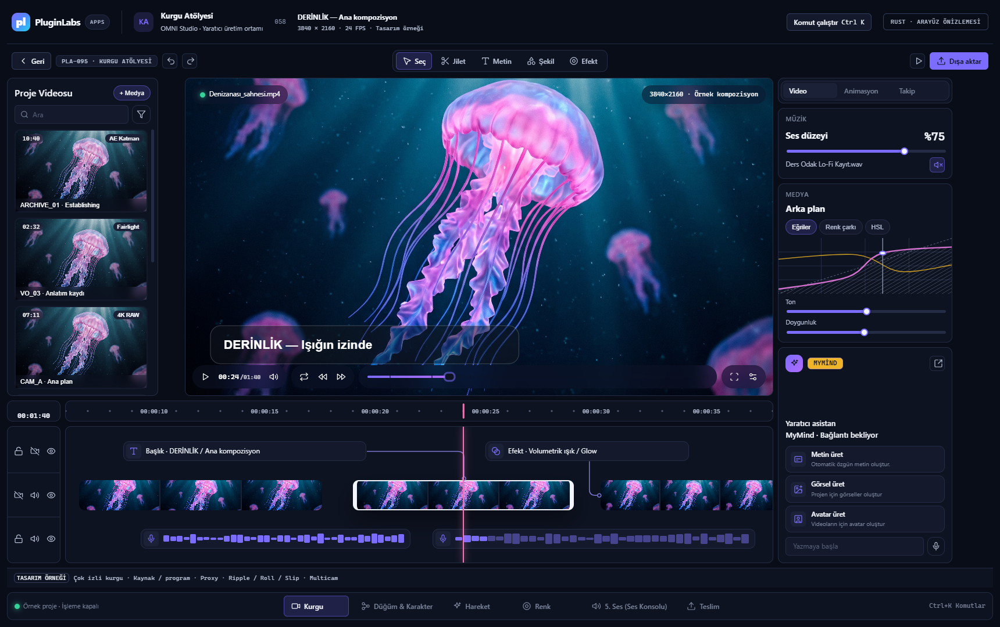
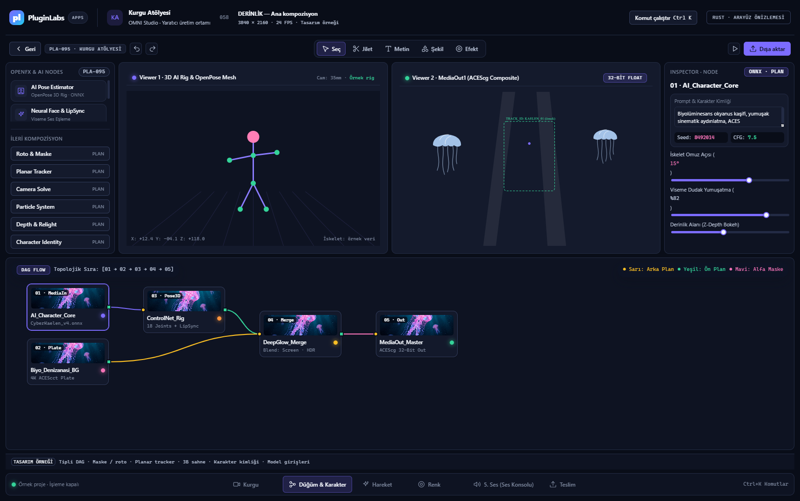
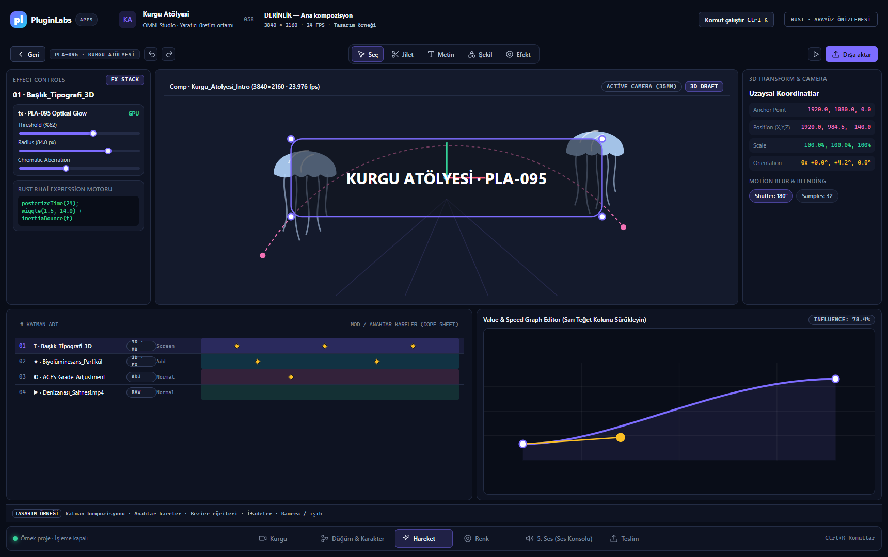
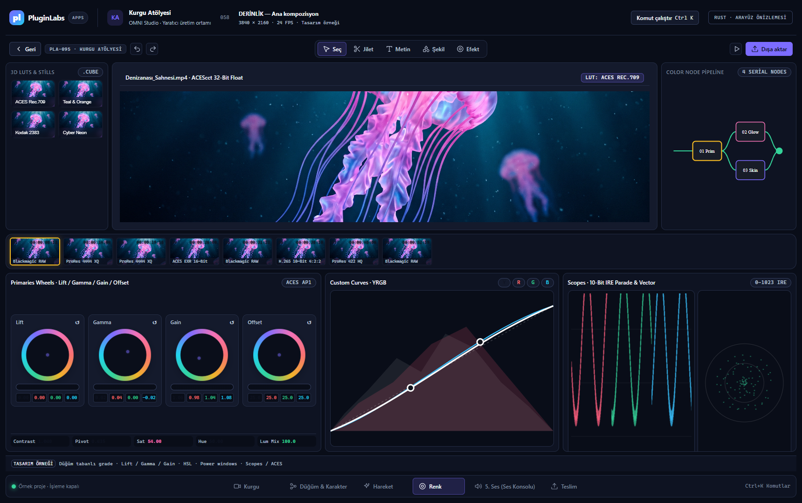

# Kurgu Atölyesi · OMNI Studio — Rust arayüz önizlemesi

04.11.2026 · PL-058 · Windows x64 · Rust / Tauri 2 / yerel WebView2.

Kullanıcının `omni_studio_pro_pla_095_multi_workspace_pluginlabs_soft_ui (2).html` masaüstü düzeni temel alındı; diğer iki HTML referansındaki çoklu çalışma alanı yaklaşımı korundu. PluginLabs Advanced kanonik CSS dosyaları yerel yüklenir. Logo + APPS + ürün kimliği, odak, yerel Inter, koyu tema ve azaltılmış hareket eklendi. Dosyalardaki komut/talimat metinleri geliştirme yönergesi olarak kullanılmadı.

Bu sürüm **önce arayüzü inceleme** isteğini karşılayan görsel adaydır. Yeni profesyonel işlevler tasarım örneği/plan olarak gösterilir. Örnek AI sonuçları, sahte render ilerlemesi ve gerçekmiş gibi donanım ölçümleri kaldırıldı. Yeni arayüz henüz medya motoruna bağlanmadı; ayrı çalışan önceki motor arayüzü `ui/studio-engine.html` altında korunur.

## Gerçek Rust uygulaması ekranları

Aşağıdaki ekranlar derlenmiş Rust uygulamasının WebView2 yüzeyinden, gerçek `snapshot` komutuyla `capabilities.rust=true` doğrulanarak alındı. Görüntüdeki içerikler örnek projedir. Kullanıcının gönderdiği denizanası JPEG'i medya/timeline/düğüm küçük resimlerinde ve aynı sahnenin still önizlemesinde yerel olarak kullanılır; AI tarafından uygulama içinde üretilmiş bir çıktı değildir.






[Ses mikseri](docs/screenshots/rust-audio-1720.png) · [Teslim](docs/screenshots/rust-deliver-1720.png).

## Çalışma alanları

| Alan | Görünen tasarım kapsamı |
|---|---|
| Kurgu | Medya havuzu, program monitörü, çok izli timeline, bağlı başlık/efekt, ses izi |
| Düğüm & Karakter | Çift görüntüleyici, tipli portlar, kablolar, karakter parametreleri, maske/roto/takip/derinlik araç kitaplığı |
| Hareket | Katman yığını, 3B kamera, hareket yolu, dope sheet, anahtar kare ve Bezier eğrisi |
| Renk | Plan şeridi, LUT still'leri, birincil tekerlekler, YRGB eğrileri, parade / vectorscope |
| Ses | Kanal mikseri, bus/insert, parametrik EQ, dinamik ve örnek loudness göstergeleri |
| Teslim | Kodek profilleri, renk/ses çıktı ayarları, kuyruk ve henüz bağlı olmayan telemetri |

Çalışma alanı geçişi, düğüm sürükleme, demo zaman çizelgesi seçimi, görsel kaydırıcılar ve Ctrl+K çalışır. Yeni arayüzdeki profesyonel render/AI/ölçüm kontrolleri işleme başlatmaz. Uygulanmış Rust çekirdeği sözleşmesi [CONTRACT.md](CONTRACT.md) dosyasındadır; bu sözleşme yeni arayüzle tam entegrasyon kanıtı sayılmaz.

## Geliştirme ve doğrulama

```powershell
cargo test --locked --manifest-path src-tauri/Cargo.toml
cargo build --locked --manifest-path src-tauri/Cargo.toml
```

Native görsel kontrol için test veri dizini ve CDP yalnız geliştirme sürecinde açılır:

```powershell
$env:WEBVIEW2_ADDITIONAL_BROWSER_ARGUMENTS='--remote-debugging-port=9227'
.\src-tauri\target\debug\kurgu-studio.exe --evidence --data-dir C:\kurgu-test
node scripts/preview-check.cjs
```

CDP argümanını normal kullanımda ayarlamayın. Sonuç ve sınırlar [PREVIEW-EVIDENCE.json](docs/PREVIEW-EVIDENCE.json) dosyasındadır. Tam Windows DPI/ekran okuyucu, kurulum sihirbazı, canlı MyMind modeli ve GPU kabulü yapılmadı. Önizleme exe'si geliştirme derlemesidir, imzalı son kullanıcı yayını değildir.

Kaynak dönüşümünü yeniden üretmek için `python scripts/adapt-reference.py <referans.html>` kullanılır (`tinycss2` gerektirir); `omni.css` ve `omni.js` ürün uyarlamasıdır. CDN, uzak font ve ağdan medya bağımlılığı yoktur. Önizleme sahnesi bu depodaki kullanıcı görselinden yüklenir.

## Sahiplik ve sonraki aşama

`codex/PL-058-rust-studio`, kaynak taban `50b611d`. UI/kabul/yayın: bu sohbet; Rust motor/paketleme: “PluginLabs video düzenleme arayüzü” sohbeti. Aynı workspace ve sürümlü ortak sözleşme kullanıldı. Kullanıcının son talimatına göre önce ekranlar sunulur; yayın ve Hub entegrasyonu görsel aday değerlendirmesinden sonra sürdürülür. Mevcut Node/Electron kaynakları korunur. Geri alma, yeni `rust-app/` adayından önceki ürün girişine dönülerek yapılabilir; kullanıcı verisi silinmez.
