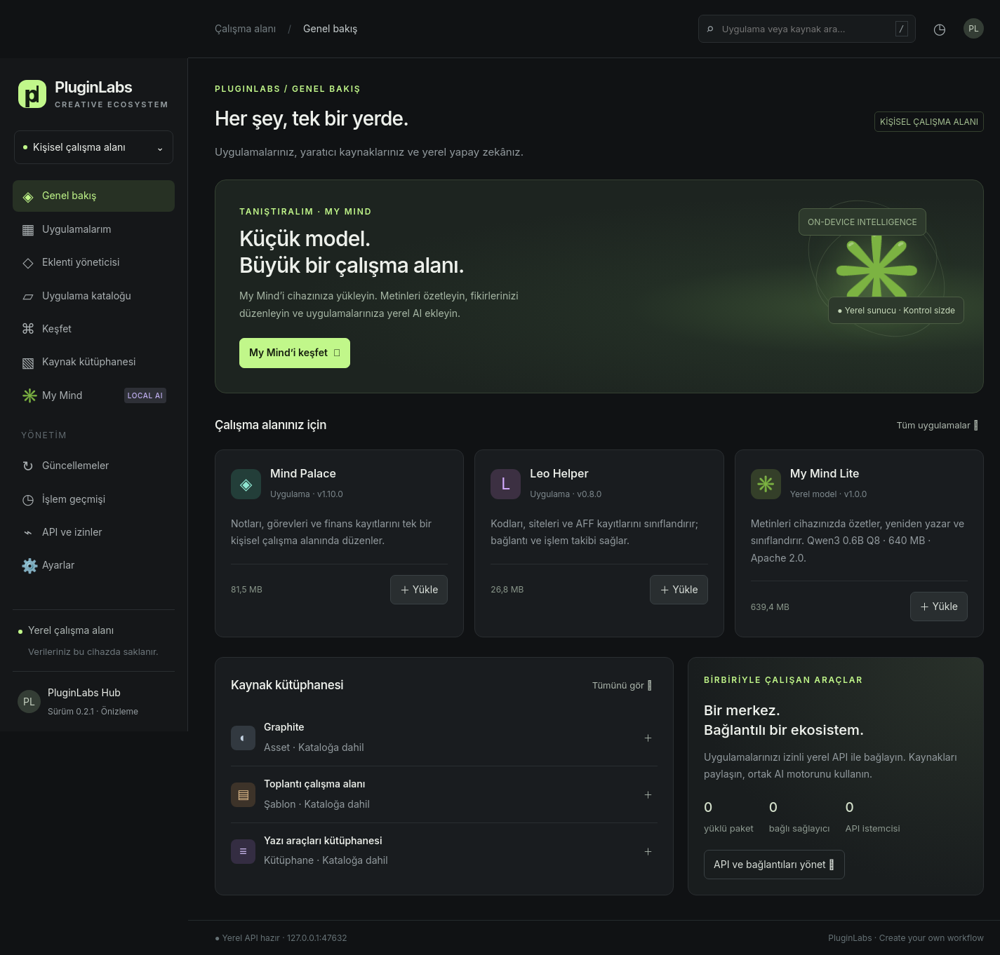
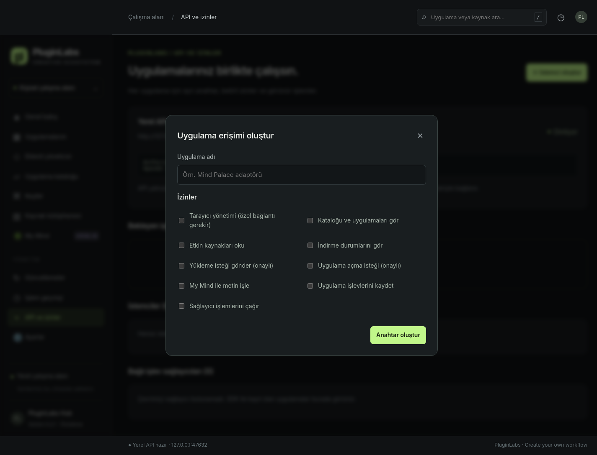

# Design System v1.0 — Hub runtime entegrasyonu

28 Ekim 2026. Takip: [issue #6](https://github.com/timdesigners-pixel/PluginLabs/issues/6). Kaynak: [PluginLabs Notion](https://www.notion.so/4038aa13d8f9803dac8df65f5a9d11b3), [tasarım konuşması](https://chatgpt.com/c/6adf6abf-1c4c-83ed-817b-02068c6ed3cd). Notion bu uygulama turunda düzenlenmedi. Çalışma, açık [sözleşme PR #5](https://github.com/timdesigners-pixel/PluginLabs/pull/5) commit `3ad9f7d7a9c947e1d6270444190dce790791d016` üzerine ayrı feature dalında hazırlanmıştır; PR #5 de #4'e bağlıdır.

## Kaynak denetimi

`ui/styles.css` dosyasının tamamı (önceki sürüm: 1117 satır, blob `1bebbfa53c5a9573ae9298f0454b74c3876073c7`), `ui/index.html`, Electron pencere/preload sınırları, paketleme, UI testleri, tarayıcı eklentisinin CSS'i, README ve katkı politikası incelendi. `docs/screenshots/` içindeki altı ürün ekranı ve iki tarihsel Windows doğrulama görüntüsü incelendi. Windows görüntüleri bu değişikliğin yeni Windows test kanıtı değildir.

| Rol | Korunan etkin değer |
| --- | --- |
| Font | Yerel Inter Variable latin/latin-ext; Segoe UI, Arial, sans-serif; body 16px/1.6 |
| Metin | Paragraf 1.75; kart açıklaması 14px/1.75; nav 14px, gap 10px |
| Renkler | bg #101214, yüzey #191c1f/#202427, sidebar #151719, çizgi #2a2e31, metin #edf0eb/#929a9e, vurgu #c1f78a |
| Yerleşim | Sidebar 268px, <=1150px'te 230px; dialog 650px; minimum pencere 1000×700 |
| Köşeler | Hero 16px, kart 12px, menü 8px, buton/form 7px, dialog 15px |
| Hero | `radial-gradient(ellipse at 85% 60%, #384d32 0%, #232e25 26%, #1d2420 62%)` |
| API kartı | `radial-gradient(at 100% 0%, #29312a, #191d1e 70%)` |
| Hareket | `no-preference` içinde 150ms buton geçişi, mevcut 5s breathe; reduce durumunda ikisi de kapalı |

Önceki 248/210px sidebar ve 560px dialog kuralları sonradan ezilir. 16px genel radius gerçek kart radius'u değildir. Eski kurallar ve toast konumundaki 124/105px offset bu kapsamda değiştirilmedi; bunlar etkin sidebar ölçüsü olarak kullanılmaz. Mevcut simge karakterleri, ürün renkleri, hero glow/orbit, breakpoint'ler ve form davranışı korunur. Eklenti paneli ayrı paket ve font/palet kullanır; bu tur ona Hub CSS'i eklenmez.

## Değişiklik sınırı

- Portable `docs/ecosystem-v1/design-system/tokens.json` tek kaynaktır. Yeni spacing/shadow ve mevcut navigation/button/field/dialog renk rolleri eklendi; Flow Dock şartname override'ları ayrı tutuldu.
- `scripts/design-tokens.cjs`, `ui/design-tokens.css` üretir. `--check` stale çıktıyı hata sayar. `npm run tokens:generate` ve `npm run tokens:check` komutları eklendi.
- `ui/index.html` yerel token CSS'ini önce yükler; `ui/styles.css` eski kısa alias'ları koruyarak temel renk/font/ölçü/gradyan ve seçili bileşen rollerini kullanır. Her literal zorla tokena çevrilmedi. JSON'daki breakpoint değeri referanstır; CSS media query içinde custom property çalışmadığından 1150px literal kalır.
- `AGENTS.md`, ana standart ve ekosistem belgeleri tek kaynak, etkin cascade, platform/ürün ayrımı ve doğrulama kuralıyla güncellendi. Yeni tema seçici veya paylaşılan runtime bileşen kütüphanesi eklenmedi.
- `test/design-tokens.test.cjs`, üretilen çıktıyı, yükleme sırasını ve kullanılan token referanslarını denetler. `scripts/verify-design-equivalence.cjs` bağımsız eski CSS girdisiyle gerçek Electron karşılaştırmasını tekrarlar.

## Doğrulama ve tekrar çalıştırma

Linux x64, Node 24.19.0, Electron 33.2.1, sanal X ekranı. Sandbox kapatma yalnız test harness'inde kaldı; üretim Electron ayarları değişmedi.

- `npm run tokens:check`: geçti.
- `npm test`: 17/17 geçti.
- `npm run test:ui`: iki native Electron akışı geçti; kaynak kurulumu/ayarları/etkinliği, API istemcisi, 50 katalog kartı, kapsam modalı, tarayıcı eşleştirme/istek kuyruğu ve uygulama eklentileri. Renderer hatası yok.
- Eşdeğerlik: 1000/1440/1600×960 pencere, reduce/no-preference ve home/ideas/extensions/API istemci dialogu/My Mind/settings = 36 durum. Seçili hesaplanan stil özellikleri ve bütün element geometrileri aynı. Geçişler tamamlanarak, sürekli animasyon fazı sıfırlanarak karşılaştırıldı. 1440px/reduce için altı tam sayfa PNG çifti byte düzeyinde aynı. Bu ölçüm hover/focus/disabled durumlarının tamamı için kapsam iddiası değildir.
- `npm run build:linux`: AppImage önizlemesi üretildi (`--publish never`). Paket `app.asar` içindeki token CSS, bileşen CSS ve HTML dosyaları kaynakla eşleşti.

Tekrar çalıştırmak için eski CSS'i açıkça seçin; karşılaştırıcı baseline'ı kendiliğinden güncellemez:

```sh
git show 3ad9f7d7a9c947e1d6270444190dce790791d016:ui/styles.css > /tmp/pluginlabs-v1-before.css
npm run tokens:check
npm test
# Linux: Xvfb çalışır olmalı; Windows'ta normal terminal yeterlidir.
node scripts/verify-design-equivalence.cjs /tmp/pluginlabs-v1-before.css dist/design-equivalence
npm run test:ui
npm run build:linux
```

Tam önce/sonra PNG'ler ve stil/geometri JSON'ları `dist/design-equivalence/` içinde, AppImage `dist/` içindedir. Bu dizinler git'e alınmaz. Aşağıdaki iki Linux görüntüsü bu kaynak ağacındaki entegrasyonu gösterir; Windows görüntüsü veya gerçek kurulum kanıtı değildir.





## Açık kabul ve geri alma

Bu Linux oturumunda Wine yok; Windows paketi, Windows 100/150/200% DPI, gerçek Windows cihazı, klavye/odak/kontrast tam kabulü ve Flow Dock WPF doğrulaması yapılmadı. Palet eşdeğerliği erişilebilirlik kabulü anlamına gelmez. CI sonuçları PR üzerinde ayrıca değerlendirilir. Bağımlılık sürümleri ve mevcut güvenlik işi #3 kapsamı değişmedi. Notion'da çift yönlü takip veya görev tamamlandı durumu iddia edilmez.

Geri alma: yalnız runtime entegrasyonu commit'ini ayrı dalda revert edip kontrolleri çalıştırın. PR #5'teki portable sözleşme, mevcut uygulama verileri ve ürün kimlikleri korunur. Merge ve release bu çalışmanın kapsamında değildir.
