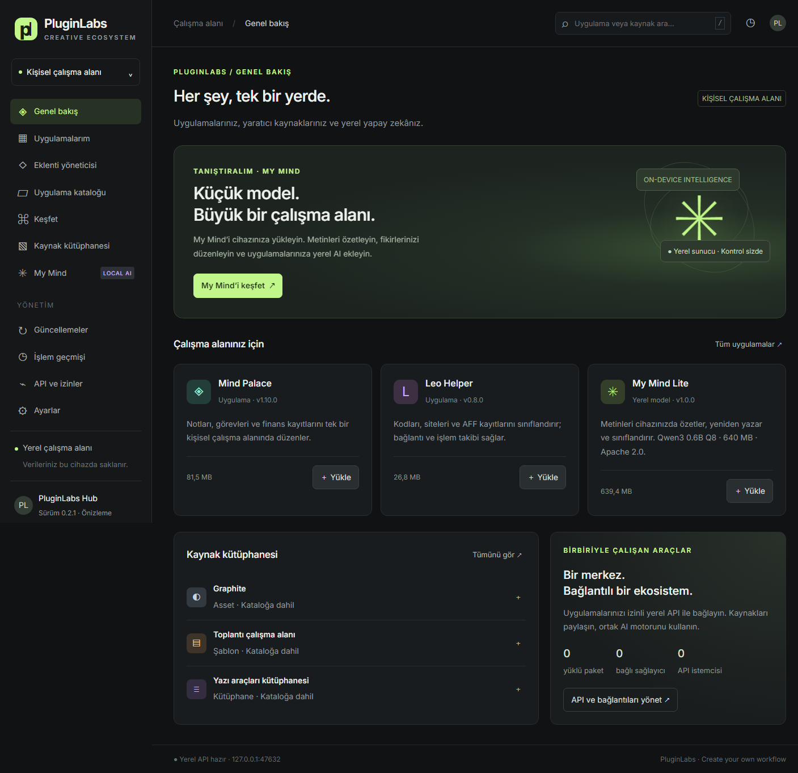

# PluginLabs ekosistem sözleşmesi v1

Mevcut Hub görünümü korunarak tasarım referansı, portable token verisi ve uygulama yayın kabul şeması hazırlanır. Tokenlar runtime'a import edilmez; bu PR kaynak UI, katalog, bağımlılık veya build davranışı değiştirmez.

- [Tasarım sistemi](DESIGN-SYSTEM.md)
- [Kaynak tokenlar](design-system/tokens.json)
- [Uygulama kabul manifesti](contracts/app-manifest.schema.json)
- [Günlük çalışma ve yerel/Cloud ayrımı](WORKING-MODEL.md)
- [Doğrusal yol haritası](ROADMAP.md)
- [Tek iş kaydı](WORK-REGISTER.json)
- [My Mind ortak altyapısı](MY-MIND.md)
- [Teslim şablonu](HANDOFF-TEMPLATE.md)
- [Geçmiş kaynakları ve inceleme sınırı](SOURCE-MAP.md)

İlk uygulama sırası: kaynak SHA ve screenshot referansını sabitle; Leo Helper ve Mind Palace için bağımsız manifest/adaptör çıkar; kurulum, açılış, güncelleme, kaldırma ve geri alma ile tasarım kontrollerini gerçek platformda doğrula. Katalog fikirlerini tamamlanmış ürün gibi sunma. Her ürünün kontrast, klavye, odak, Türkçe, reduced-motion, DPI ve durum kontrolleri passed olmadan uyumlu ilan etme. Şema henüz Hub tarafından çalıştırılan bir yayın kapısı değildir.

Mevcut kart radius 12px, genel radius 16px; son sidebar genişliği 268px/230px. Bu değerler ortak politika nedeniyle değiştirilmez. Flow Dock kendi platform/vurgu adaptörüyle devam eder.

Bu PR #4 geliştirme standardının üzerine hazırlanmıştır. Main merge ve uygulama release ayrı insan onayı gerektirir.

Ekran geçmiş Windows doğrulamasındandır; bu dokümantasyon değişikliği yeni bir derleme veya cihaz testi üretmez.
