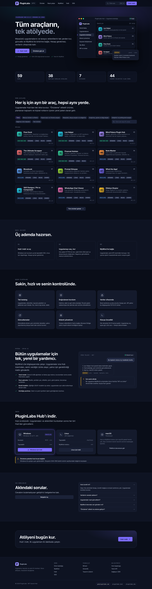
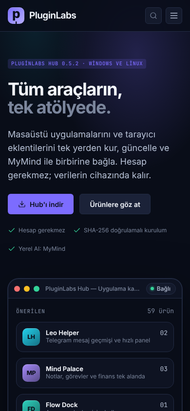
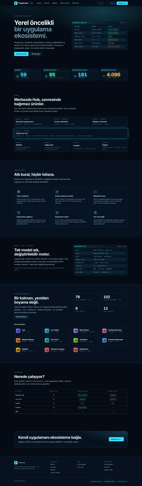
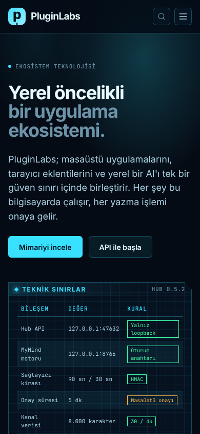
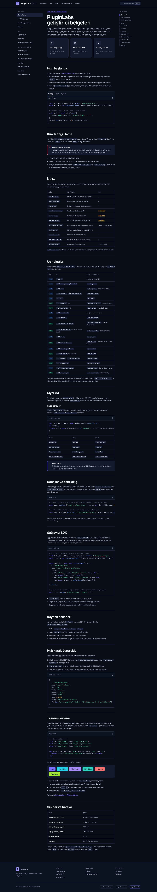
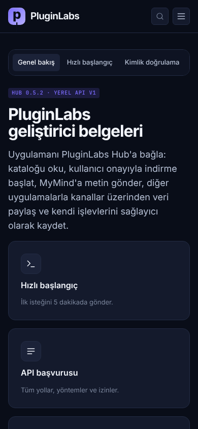
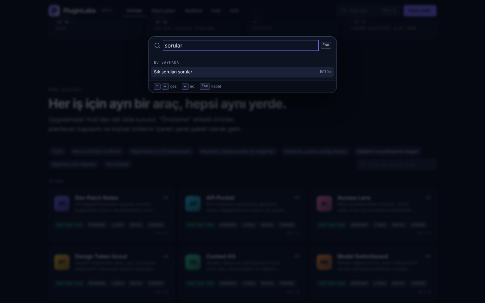

# PluginLabs web siteleri

Üç alan adı için statik ön yüzler. Derleme adımı yoktur; her klasör olduğu gibi herhangi bir statik barındırmaya yüklenebilir.

| Site | Klasör | Rol | Yüzey |
| --- | --- | --- | --- |
| getpluginlabs.com | `getpluginlabs.com/` | Ürün tanıtımı, ürün kataloğu, Hub indirme, SSS | Varsayılan koyu · `hub` aksanı |
| pluginlabs.tech | `pluginlabs.tech/` | Ekosistem mimarisi, güvenlik modeli, MyMind, tasarım sistemi, platform desteği | `hud` yüzeyi |
| pluginlabs.dev | `pluginlabs.dev/` | Geliştirici belgeleri: yerel API, izinler, MyMind, kanallar, sağlayıcı SDK | Varsayılan koyu · belge yerleşimi |

## Tasarım sistemi

- PluginLabs Advanced katmanı: `pl-tokens.css` → `pl-components.css` → `pl-advanced.css` → `site.css`.
- Kök: `<body class="pl-site" data-pl data-pl-theme="dark" data-pl-product="hub" lang="tr">`.
- Web'e özgü kalıplar `_ortak/site.css` içinde `pl-site-` önekli; yalnız `var(--pl-…)` kullanır, global element seçicisi yazmaz.
- Logo MH-4 düzenindedir: `pl` karosu + "PluginLabs" + site etiketi (`APPS`, `TECH`, `DEV`); ürün kartları aksan simge, ad, alt başlık ve sıra numarası taşır.
- Her sitede Ctrl/⌘ K komut paleti vardır.

## Klasör düzeni

```
sites/
├── _ortak/            ← kaynak: site.css, site.js, favicon.svg, fonts/
├── getpluginlabs.com/ ← index.html + assets/ (üretilen)
├── pluginlabs.tech/
└── pluginlabs.dev/
```

`assets/` klasörleri elle düzenlenmez. Değişiklik `_ortak/` ya da `design-system/pluginlabs-advanced/assets/` içinde yapılır, ardından:

```sh
node scripts/sites-sync.cjs          # varlıkları kopyalar, veri.js üretir
node scripts/sites-sync.cjs --check  # fark varsa hata verir
node --test test/sites.test.cjs
```

`veri.js`, `registry/projects.json` ve `src/catalog.cjs` kayıtlarından üretilir; ürün sayıları ve kataloğu bu iki kaynakla aynı kalır.

## Yerelde önizleme

Fontlar `file://` üzerinden yüklenmez; bir HTTP sunucusu kullan:

```sh
npx --yes http-server sites/getpluginlabs.com -p 8080
```

## Ekran görüntüleri

Chromium (Playwright), Linux, 1440×900 tam sayfa ve 390×844 telefon; `c94a6d7` üzerindeki bu dal.

| Site | Masaüstü | Telefon |
| --- | --- | --- |
| getpluginlabs.com |  |  |
| pluginlabs.tech |  |  |
| pluginlabs.dev |  |  |

Komut paleti: 

## Yayın

Alan adları ve barındırma bu depoda yapılandırılmamıştır. Her site klasörü bağımsız bir statik proje olarak (ör. Netlify, Vercel, GitHub Pages) kök dizini o klasör olacak şekilde yayımlanır.
